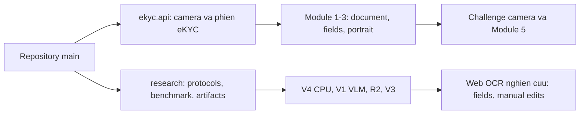

# Rà soát branch và cấu trúc vận hành

Rà soát ngày 2026-11-03, sau benchmark, audit và bốn thử nghiệm OCR qua trình duyệt.
Kết luận: các nhánh tạo thành một chuỗi tổ tiên, đủ điều kiện fast-forward;
không cần chọn bên khi giải quyết conflict hoặc ghi đè luồng mentor. Nếu ref
remote đổi hoặc kiểm tra tổ tiên không còn đúng, bước cập nhật main phải dừng.
Giữ toàn bộ branch; không force-push, squash hoặc xóa nhánh.

## Ý định và phạm vi từng nhánh

| Branch | Mốc khi rà soát | Mục đích | Cấu trúc và đầu vào/đầu ra |
|---|---|---|---|
| main | `11ddb8f` trước tích hợp | Điểm nhận mã đã kiểm tra | Nhận cả runtime eKYC và namespace nghiên cứu, không trộn contract API |
| mentor/ekyc-v3.2.0 | `4110f22` | Camera eKYC 3.2.0 | `ekyc/`, `web/`, `scripts/`; phiên giấy tờ → form → challenge → selfie |
| research/document-recovery-core-b | `c326328` | Nghiên cứu khôi phục/V4, OCR đầu cuối, VLM V1 | `research/recovery_*`, `vlm_*`, kết quả/protocol; các baseline được giữ nguyên |
| research/vlm-v2-evidence | `3a02488` trước các bổ sung cuối | R2/V3 LoRA có đối chứng và tham chiếu nhiều nguồn | `v2_*`, `v3_*`; benchmark riêng, web nghiên cứu, raw/cache/weights ở máy |

Quan hệ đã kiểm tra: main → mentor → research/document-recovery-core-b →
research/vlm-v2-evidence. Mã runtime `ekyc/`, `web/`, `scripts/`, hai launcher
mentor và requirements không đổi giữa mentor và các nhánh nghiên cứu.
So với thư mục chạy gốc, 46 file runtime trùng nội dung khi chuẩn hóa CRLF/LF/BOM;
không chép đè mã thư mục gốc. Các khác biệt xuống dòng không phải thay đổi thuật toán.

## Luồng mentor: chức năng và liên kết

| Thành phần | File chính | Hành vi và liên kết |
|---|---|---|
| Module 1 | `ekyc/module1_quality.py`, `pipeline.py`, `feedback.py` | Đánh giá chất lượng, dừng ảnh gần đen/rỗng/quá nhỏ; thử cứu vùng giấy tờ trước khi loại vì nền ảnh; trả hướng dẫn chụp lại |
| Module 2 | `ekyc/module2_homography.py` | Tìm/nắn vùng thẻ từ pixel; khi chưa xác nhận biên, có thể cho xem chữ nhưng không lấy khuôn mặt ngoài thẻ làm chân dung giấy tờ |
| Module 3 | `ekyc/module3_ocr.py`, `scanocr.py`, `document_fields.py`, `document_portrait.py` | ScanOCR/VietOCR, thông tin theo nội dung giấy tờ, raw text và chân dung; fields còn sửa được, không mặc định mọi thẻ phải có CCCD |
| Module 4 web | `live_challenge.py`, `face_observation.py`, `presentation_attack.py`, `api.py` | Bốn động tác ngẫu nhiên, tối đa 180 giây; đo mắt/hướng đầu/ánh nhìn và PAD RGB; proof có hiệu lực 45 giây, chưa phải PAD certification |
| Module 4 CLI cũ | `module4_liveness.py` | Phân tích file video/offline; không thay cho challenge web có nonce |
| Module 5 | `module5_matching.py`, `pipeline.py`, `api.py` | SFace so chân dung giấy tờ với mẫu challenge và selfie cuối; cần tất cả mẫu thống nhất, không chỉ khung tốt nhất; `identity_verified=false` |

Các endpoint mentor `/api/document`, `/api/confirm`, `/api/liveness/*`,
`/api/selfie` giữ nguyên. Không đưa output nghiên cứu thiếu portrait/session
token vào Module 5. Các embedding/nonce và TTL vẫn thuộc phiên mentor.

## Namespace nghiên cứu

- V4 đo nắn/khôi phục, trích chữ, ghép nhãn và chi phí/khả năng yêu cầu xem lại.
  Kết quả âm của cascade được giữ; không đổi số đo cũ sau khi thêm VLM.
- V1 là Vintern LoRA trước đây. Bảo toàn 101 file theo artifact index.
- R2 có complete/partial cùng ID/slot, hai seed, 320 bước và 1280 lượt ảnh mỗi run.
- V3 giữ cùng pixel và thay giám sát bằng các nguồn khai báo/TD3, có giới hạn
  độ đầy đủ của ngày. Đây là task 17 key tùy chọn, không phải mọi thông tin có thể suy ra.
- Bốn lượt R2 và hai lượt V3 là sáu lần LoRA của cùng một backbone multimodal,
  không phải sáu backbone LLM khác nhau. Vision/projector vẫn được dùng và đóng băng.
- CPU/MRZ và các bổ sung alias được tách thành cấu hình chấm riêng. Output được
  chia sẻ không được tính thành lượt suy luận độc lập mới.

## Tương thích vận hành

| Chế độ | Cổng mặc định | Cách chạy |
|---|---:|---|
| eKYC mentor | 8000 | `.\start.ps1` |
| OCR V3 hiện tại | 8003 | `.\start-source-v3.ps1` |
| OCR V2 trước | 8003, thay thế V3 | `.\start-vlm-v2.ps1 -Port 8004` nếu cần cổng riêng |
| V4/V1 trước | 8001/8002 theo hướng dẫn riêng | `research/README.md`, `VLM_REPRODUCE_VI.md` |

V2/V3 có API/schema nghiên cứu, không mount các app có cùng route `/` và
`/api/health` vào chung app mentor. Cùng cổng mặc định là hai lựa chọn phiên bản;
launcher dừng ngay nếu cổng đang thuộc app khác. Đã kiểm tra V2 trên 8004 cùng lúc
V3 trên 8003, xác nhận app_id rồi dừng đúng server thử. Không có phép đo nhiều
model GPU suy luận đồng thời; các benchmark được chạy tuần tự.

Python CPU của mentor và overlay CUDA dùng riêng cho child process nghiên cứu;
không nâng dependency toàn cục. Trên máy hiện tại, worktree dùng liên kết tới
venv/weights/dataset sẵn có. Không tạo venv, tải model mới hoặc thêm raw data vào Git.
Source-only clone cần asset từ manifest; cấu hình local không được giả định đã
đi kèm repository. Hai launcher nghiên cứu dùng ASCII và đã qua Windows PowerShell 5.1.

## Bằng chứng hoàn thành và giới hạn

- 269 kiểm tra Python, 1496 subtest và 33 kiểm tra frontend qua. Test giả camera
  chỉ kiểm tra hành vi phần mềm. Camera thật chưa được dùng đánh giá.
- 1152 lượt test VLM, 8 phương án ×144 ảnh. R2/V3 CPU có 432 cặp output độc lập khớp.
- Audit R2 phát lại 1728 hàng, V3 phát lại 3024 hàng; đây là số hàng chấm, không phải
  số ảnh độc lập. 1112 cache vision khớp trích xuất lại từ pixel.
- 32 lượt pixel-level bổ sung dùng chung panel 8 ảnh/4 giấy tờ, không phải 16 ảnh độc lập.
  Một lượt V1 bị sleep do pin được kiểm tra riêng từ feature cache và khớp hash;
  số đo thời gian gốc được giữ, có phân tích độ nhạy riêng.
- MRZ fusion có 1728 phép ghép chấm lại, 0 lượt hybrid mới vì dev không chọn nó.
  Chẩn đoán alias CPU hậu nghiệm phát lại 1728 hàng, 0 lượt neural mới; không thay
  benchmark chính hoặc cổng triển khai. Không phải baseline SOTA.
- Web thực tế: bốn lần OCR hoàn tất, số trường 5/1/1/5; ba mẫu train và một mẫu giả
  lập mới. Đã kiểm tra nguồn OCR/manual, thêm/sửa/xóa. Đây không phải điểm benchmark.
- 101 file V1 và 63 file V4 được bảo toàn byte. Mentor runtime không bị thay bởi VLM.
- V3 F1=0,3947/0,4063, so với partial cùng seed 0,3786/0,3978; CI 95% đều chứa 0.
  Web vẫn dùng lựa chọn từ dev là `partial_42`, chỉ chế độ nghiên cứu vì gate=false.
- Chưa có nhãn legibility độc lập hoặc bộ camera mới có phép. Các baseline CPU có
  giới hạn ngôn ngữ/ghép nhãn. Chưa đủ để khẳng định novelty/hiệu quả đạt CORE B.

Xem [kết quả](research/V3_RESULTS_VI.md), [bản thảo](research/V3_PAPER_DRAFT.md)
và các JSON audit/provenance.
Ảnh chụp màn hình thử nghiệm chỉ ở máy. Không publish ảnh giấy tờ, raw OCR values,
nhãn riêng, session/biometric data hoặc weights LoRA/full model.
