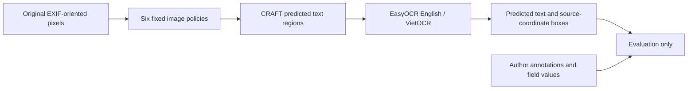

# Source and measurement audit for end-to-end OCR, 2026-10-30

## What changed from the earlier diagnostic

The previous 58-field experiment normalized **ground-truth field crops** before
recognition. It isolated cropping harm but did not measure text localization.
The new predictor has no GT argument. It sees source pixels and produces its
own text boxes and transcriptions; field labels/coordinates are used afterwards
by the evaluator. It measures spatially matched field transcription, not semantic
field naming, document authenticity, liveness or eKYC approval.

## Reused components and primary sources

| Component | Source / verification | Purpose and limits |
|---|---|---|
| MIDV500/2019 | Author annotations, source block/CRC audit already in v1 | Fixed 91 three-corner cases plus 50 controls from existing frame15 sample; correlated video and prior model exposure remain limitations. |
| MIDV-2020 | [Dataset paper](https://arxiv.org/abs/2107.00396), author FTP, local image hashes | Existing20 mock identities, ten overlapping template types and two capture conditions. Not a representative Vietnamese CCCD benchmark. |
| DocAligner FastViT-SA24 | [Author implementation](https://github.com/DocsaidLab/DocAligner), [published weight hash](https://docsaid.org/fr/models/docaligner) | Same pinned ONNX, fresh inference. Upstream train/test identity overlap not independently resolved. |
| CRAFT text detector | [Baek et al., CVPR2019](https://arxiv.org/abs/1904.01941), [EasyOCR1.7.2 weight registry](https://raw.githubusercontent.com/JaidedAI/EasyOCR/v1.7.2/easyocr/config.py) | Generic predicted text regions, no annotation-guided detector hints. Official MD5 and local SHA256 verified. |
| EasyOCR English generation2 | Same pinned EasyOCR registry and installed source hashes | Existing English recognizer; its alphabet does not cover every Latin diacritic. It is not a Vietnamese OCR accuracy claim. |
| VietOCR VGG Transformer | [Author repository](https://github.com/pbcquoc/vietocr), existing weight/config URLs and SHA256 in mentor model manifest | Existing Vietnamese-capable line recognizer. The exact current model/config is retained. Other languages and some Latin characters may be unsupported. |

The mentor ScanOCR specialized field detector is not used as a generic detector
for international MIDV cards. Its existing **VietOCR recognizer** is reused.
No new environment, dependency installation, training or model download occurred.
The numeric manifest lists actual local weight size/hash and installed package
source hashes, so a name alone is not treated as provenance.

The two recognizers share the same CRAFT detector; these are not two fully
independent OCR systems. EasyOCR's predicted-line crop utility produces
grayscale, height-normalized patches. VietOCR receives those same grayscale
patches converted to RGB and applies its pinned input normalization. Therefore
this benchmark does not establish equivalence to the mentor's original
color-crop VietOCR path, and a future color-input ablation must be labelled as
a separate experiment rather than silently replacing these results.

## Performance implementation audit

VietOCR groups only tensors with identical width; it never pads one line to match
a different width. Batches have at most8 lines, and each line stops contributing
after its own EOS. Eight fixed synthetic lines, including rotated variants,
were compared with the original single-line implementation before real OCR:
text mismatches0; largest confidence difference4.36e-7 (allowed1e-4). This is
an implementation parity check on these cases, not proof for all possible inputs.

CRAFT and each recognizer are measured with perf_counter wall time and process
CPU time. Decode, localization, transform and inverse coordinate mapping are
also measured. Model loading/warmup and GT scoring are kept separate. Equivalent
policy rasters within one image can share one execution; its stage time is
charged to each equivalent policy. No prediction is reused across repeat passes.
Results are serial desktop CPU timings with shared resident models, not server
throughput, peak-memory or exclusive-machine benchmark guarantees.
Policy execution order is fixed within an image; image order is shuffled.
Cache/shape warmup effects can affect comparisons, so timing differences must
not be described as an unbiased standalone-server speed guarantee.

## Experiment schedule and preserved deviations

The original three-full-pass plan was revised **before OCR accuracy was
inspected**, after six engineering pilot images showed high CPU cost.
The pilot manifest, original protocol and private completed checkpoints remain.
The final main schedule is161 images once, then the same32-image panel twice:
225 image executions. The panel has24 distinct three-corner IDs, four different
four-corner primary IDs and four external IDs, chosen by an immutable hash rule.

Main accuracy uses the full first pass. Repeat statistics compare the same32 in
all three passes. Averaging161-image accuracy with32-image accuracy would be
incorrect and is explicitly avoided. Stopped/failed attempts are not successful
runs, and the pilot is not silently merged into the main benchmark.

## Privacy and interpretation

Source/recognized strings and predicted boxes remain in Git-ignored local
checkpoints for audit. Public results contain hashes, counts, edit distances,
field keys, confidence summaries and stage timings. Unsupported/partial fields,
images with no eligible target, no-text outcomes and review decisions have
explicit counts. No known field is required of every card type.

Repeated inference is not more independent data; bootstrap units are physical
documents. Confidence is not correctness. Alphabet-support diagnostics will
explain reader limitations without redefining the main target after outcomes.
