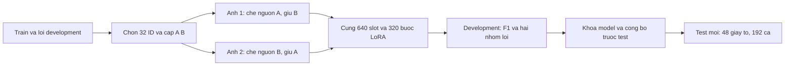

# Cặp che nguồn thông tin và giữ trường bên cạnh

Mục tiêu là sửa hai hành vi đối nghịch trong cùng một lượt học: điền thông tin
khi các nguồn đã khai báo đều bị che, và bỏ sót trường nguyên vẹn cạnh vùng che.
Đây là một can thiệp dữ liệu cho LoRA hiện có, chưa phải tuyên bố phát minh
masking, counterfactual learning hoặc MRZ fusion.

Một key có thể có nhiều cách hiện chữ: thân thẻ, bản dịch, dòng lặp và đoạn MRZ
được tác giả liên kết. Chỉ che một ô thân thẻ chưa đủ để gán nhãn thiếu nếu một
nguồn khác vẫn còn. Vì vậy mask A được dựng từ hợp của mọi vùng giá trị đã khai
báo cho A; B phải còn ít nhất một cách hiện ở thân thẻ nguyên vẹn, kể cả các
thành phần dòng/nhãn cần thiết. Ảnh thứ hai đảo chiều để cùng một trường vừa có
ví dụ phải bỏ, vừa có ví dụ phải đọc.

| Tình huống | Nhãn dùng để học |
|---|---|
| A bị che ở thân thẻ nhưng còn nguồn MRZ khai báo | A vẫn có nguồn hỗ trợ |
| Mọi nguồn A khai báo bị che; B còn nguyên | B có trong đáp án; A được bỏ |
| Không giữ được B hoặc không có cặp gần phù hợp | Giữ slot cũ hoặc fallback đã đăng ký; đếm riêng |
| Chỉ thấy năm hai chữ số | Giữ độ chính xác quan sát được, không thêm thế kỷ |

Việc dùng nhãn/vị trí chỉ xảy ra khi dựng dữ liệu và chấm điểm offline. Model
suy luận nhận pixel ảnh và prompt17 key tùy chọn, không nhận key dự kiến cho từng
ảnh, mask, tọa độ chuẩn hoặc đáp án. Những trường không đọc được không được điền
bằng cách tra danh tính trong dataset.

Giữ nguyên128 ID,5 slot/ID,2 epoch,1280 lượt ảnh,320 update và hai seed. Chỉ64
slot của32 ID đã chọn được thay. Đối chứng uniform-source V3 có cùng seed,
ID/slot exposure và checkpoint cuối. Token đáp án có thể khác và được công bố;
thiết kế hiện tại không tách riêng tác động chọn ca khó khỏi giữ ngữ cảnh đầy đủ
hoặc generic paired augmentation.

Nhãn vẫn là bằng chứng hình học từ vùng tác giả/generator. Chúng không chứng
minh chữ còn đọc được sau glare/blur hoặc mọi nguồn thông tin thực tế đã biến mất.
Do đó báo cáo gọi lỗi là output mất nguồn khai báo, không tự coi mọi lỗi đó là
hallucination hay giấy tờ giả. Chưa có nhãn người hoặc bộ camera người dùng mới.

Code: `hp_data.py`, `hp_metrics.py`, `hp_study.py`. Ngân sách và cách chấm đã
đăng ký trong `HARD_PAIR_PROTOCOL.md`; nhật ký/checkpoint ở cache local.
