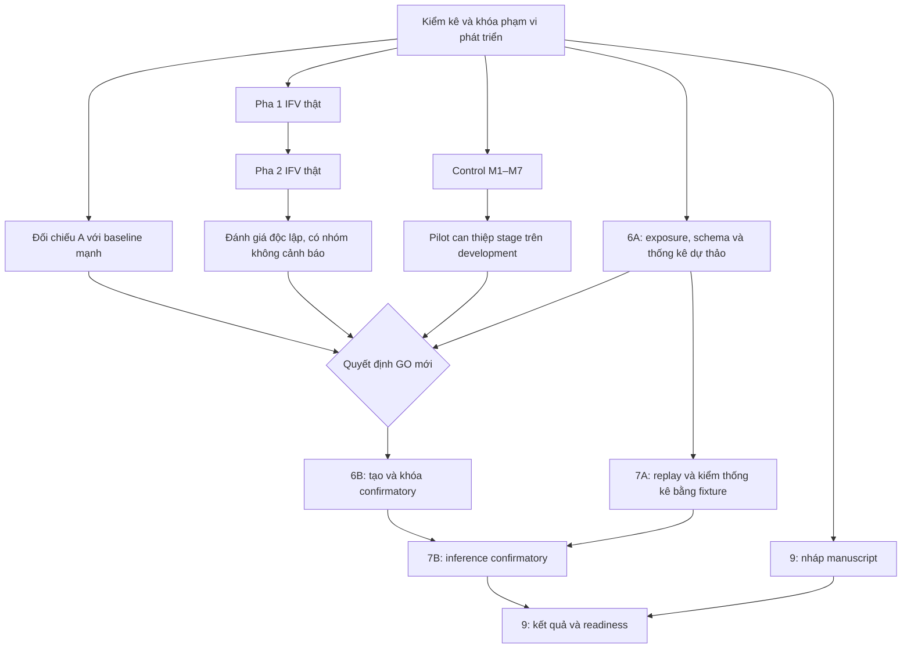

# EASE 2027 · Master execution

Checkpoint `master_01`, ngày local 09/11/2026. Phần development và chuẩn bị đã chạy. **IFV WAITING_FOR_HUMAN_REVIEW. TASK 6B/7B NO-GO. Manuscript ở mức draft.** Worktree local `research-document-recovery` trên `main`, HEAD `f5d130d93525e7633053edc03e6d9f6edeba7a6f`. Evidence Contract nằm trong mục untracked có sẵn. Không có tracked/staged diff. Worktree mentor sạch khi tiếp nhận.

Cập nhật 11/11/2026 tiếp tục đúng các TASK 6A, 7A, 8 và 9 bên dưới. Người dùng đã hoãn IFV. Phần việc độc lập với nhãn đã được hoàn thiện trong phạm vi hiện có. **0 inference hoặc training mới trong lượt tiếp tục này.** [Manifest lượt tiếp tục](execution/master_01/continuation_20261111/completion_manifest.json)

## Nhật ký thực thi

| ID | Mục tiêu / dependency | Trạng thái | File thay đổi và artifact | Test / model calls thực tế | Giới hạn và bước tiếp |
|---|---|---|---|---|---|
| M0 | Phục hồi từ local, đọc kế hoạch và kiểm artifact TASK 0–5.5 | PASS | [Intake code](master/intake.py), [receipt](execution/master_01/intake.json), [sau thực thi](execution/master_01/preservation_after.json) | Đọc lại tài liệu 695 dòng, đối chiếu 93 cache envelope, 23 tài sản checkpoint. 2.746 file và 6 log inference cũ khớp hash sau lượt. 0 calls | Không thấy Python/Uvicorn/Node nghiên cứu khi kiểm tên process. GPU owner bị giới hạn quyền. Server loopback phục vụ QA đã đóng |
| IFV | Giữ mù pha 1, khóa thật rồi mới mở pha 2 | PASS tooling, WAITING_FOR_HUMAN_REVIEW dữ liệu | [Report code](master/ifv_report.py), [trạng thái](execution/master_01/ifv_waiting.json), [Browser receipt](execution/master_01/ifv_browser_attempt.json), [phiếu đã có](local/task55_blind_review_v1/index.html) | 7 JavaScript test, gồm lưu/export/nạp draft, asset binding và thứ tự mở output trong fixture. Kiểm reporter bằng Python. 0 calls | 0 phiếu thật. 31 ảnh, 86 ô pha 1 và tối đa 46 ca pha 2. Timeout UI thật. User xuất JSON và gửi đường dẫn. Một người chấm chỉ dùng mô tả pilot |
| DIAG | Đối chiếu A/B0–B3/A_flat và ablation, cần audit đã có | PASS | [Diagnosis](A_B3_CAUSAL_DIAGNOSIS.md), [Coverage](CONTRACT_COVERAGE_MATRIX.md), [Methods](METHOD_DIFFERENCE_REPORT.md), [replay](execution/master_01/method_decision_replay.json) | Đối chiếu trên 120 verdict chính và 12 diagnostic. 0 calls | 42 khác biệt do precondition gốc. A không có alarm riêng trên panel. 41 B3-only chưa biết là đúng hay sai. Đợi IFV |
| MUT | Fault injection M1–M7 và oracle kiểm độc lập, dùng fixture | PASS development | [Code](master/faults.py), [results](AUTOMATED_FAULT_INJECTION_REPORT.md), [log](execution/master_01/faults_01.log) | 14 ca, 13 valid, 7 lỗi seeded quan sát. A và B3 cùng 5/5 structured fields. 0 calls | JSON và attribution có checker riêng. Chưa xác nhận lỗi tự nhiên hoặc coverage trên lịch sử bug |
| A+B / 8A | Can thiệp M2 trên cùng input, cần control và quota | PASS pilot, exploratory | [Runner](master/propagation.py), [Protocol](FAILURE_PROPAGATION_PROTOCOL.md), [Stage results](STAGE_INTERVENTION_RESULTS.md), [Value analysis](A_PLUS_B_VALUE_ANALYSIS.md) | 12 request, 2 dùng cache cũ và 10 CPU mới. 0 calls khi replay. Có receipt M3 gắn raw payload. 0 GPU | 3 ID, 1 reader, crop chủ động. 4 trường đúng→sai sau crop đều mất nguồn; trường đích vốn sai 3/3. Cần independent cause và flat stage baseline cùng thông tin cho claim mạnh |
| TRAIN | Chọn SUT đủ cho RQ | NO-TRAIN | [Quyết định](NO_TRAIN_DECISION.md) | 0 training. Các reader cũ đã ghim | Nếu cần transfer thì dùng checkpoint đã có trước, theo design cân bằng |
| 6A | Exposure, schema, SAP và preflight, cần metadata cho phép | PASS draft | [Design](CONFIRMATORY_PREPARATION_6A.md), [Exposure](execution/master_01/exposure_audit_final.json), [prelock](execution/master_01/prelock_readiness_v2.json), [SAP](STATISTICAL_ANALYSIS_DRAFT.md) | 14 nhóm metadata. Test ảnh khác bytes trùng pixel, overlap các trục và draft guard. 0 calls | Pixel và alias lịch sử có lỗ hổng. Pretraining unknown. Cần dữ liệu độc lập, nhãn, adequacy và quyết định mới |
| 6B | Khóa test xác nhận sau GO | BLOCKED | [Gate](REVISED_GO_NO_GO.md), [amendment](MASTER_RESEARCH_AMENDMENT.md) | 0 calls | Chưa có GO, verified endpoint, specimen manifest mới, đủ cụm hoặc lock. Không có test output mới được mở |
| 7A | Cache/resume, thống kê, replay và báo cáo | PASS tooling | [Hướng dẫn](TASK7_REPLAY_AND_REPORTING.md), [stats](master/statistics.py), [Python log](execution/master_01/master_python_03.log), [UI log](execution/master_01/master_ui.log) | 28 Python, 7 JS qua. Paired bootstrap, sign flip, Holm và CI/NA thử bằng fixture. Replay 0 calls | CI và metric IFV thực để NA, không lấy synthetic sizing làm power quan sát |
| 7B | Chạy confirmatory theo lock 6B | BLOCKED | [Gate 6A](execution/master_01/prelock_readiness_v2.json) | 0 calls | Đợi GO hợp lệ và lock trước khi chạy |
| 9A | Nháp manuscript, bảng claim, tài liệu tái lập, CFP | PASS draft | [Manuscript](paper/MANUSCRIPT_DRAFT.md), [BibTeX](paper/references.bib), [Claim ledger](paper/CLAIM_TO_EVIDENCE.md), [Replication](paper/REPLICATION_PLAN.md), [Checklist](paper/SUBMISSION_READINESS.md) | Kiểm CFP chính thức và nguồn BibTeX. Không có inference cho viết paper | Confirmatory results để placeholder. Cần định dạng ACM và audit ẩn danh trước nộp |
| 9B | Paper readiness và chọn track với bằng chứng | BLOCKED | [Checklist](paper/SUBMISSION_READINESS.md) | 0 calls | Research Track là mục tiêu. Short/RENE có điều kiện về mức đóng góp và bằng chứng. Chưa quyết định chuyển track hay nộp |

Các lượt thất bại được giữ. Lượt đọc stage receipt đầu sai khóa runtime; sửa riêng hậu kiểm, replay không gọi model. Lần mô phỏng sizing đầu không serialize NumPy integer; bản `_v2` có regression test. Tổng lượt này **10 CPU, 0 GPU, 0 training**. Các lượt cache/replay không tính vào inference mới. [Manifest bàn giao](execution/master_01/delivery_manifest.json)

## Nối lại từ checkpoint này

1. Mở lại worktree `D:/laptrinhcuatao/Ekyc/versions/research-document-recovery`. Kiểm `git status --short` và HEAD. Đọc file này, [bảo toàn cuối lượt](execution/master_01/preservation_after.json) và [preflight](execution/master_01/prelock_readiness_v2.json). Không cần chạy lại intake, TASK 5 hoặc stage execute đã có. Dùng receipt cache và replay của checkpoint này.
2. Khi người chấm gửi JSON pha 1 thật, dùng venv có sẵn và [hướng dẫn import](IFV_REVIEW_GUIDE.md). Khóa snapshot theo SHA do importer in ra, rồi mở pha 2 cho reviewer đó. Một người chấm đủ để chạy mô tả. Giữ reviewer exposure và bất đồng chưa adjudicate.
3. Sau khi có JSON pha 2 thật đã niêm phong, chạy `python -B -m research.evidence_contract.master.ifv_report --submission <sealed output_observations.json>` từ worktree bằng venv hiện có. Report JSON/Markdown giữ riêng pointwise, relation, ca chưa chấm và CI theo ID. Chưa có file người thì giữ `WAITING_FOR_HUMAN_REVIEW`.
4. Chốt independent reference, chọn claim phân biệt được với B3/gated V3/flat, tính lại adequacy và quyết định GO mới. Chỉ sau đó mới tạo và khóa bộ confirmatory. A tiếp tục là hướng chính đang kiểm chứng. A+B là nhánh exploratory. [Phương án và gate](MASTER_RESEARCH_AMENDMENT.md) · [Các điều kiện 6A](CONFIRMATORY_PREPARATION_6A.md)

Nguồn checkpoint cũ gồm [báo cáo phục hồi](RECOVERY_STATE.md), [gate](REVISED_GO_NO_GO.md) và [audit](TASK5_5_AUDIT.md).

## Phần hoàn thiện thêm ngày 11/11/2026

| TASK | Việc thực sự hoàn thiện | Kiểm chứng và trạng thái còn lại |
|---|---|---|
| 6A | Validator nhận diện hai path Windows cùng file, chặn nội dung author mâu thuẫn trong một ID và trùng semantic key sau chuẩn hóa. Kiểm hash binding của draft, exposure và manifest stage với receipt | Fixture thử path alias, content conflict, file thay hash và file thiếu. Metadata exposure cũ khớp receipt. Gate giữ BLOCKED. [Binding](execution/master_01/continuation_20261111/draft_binding_verification.json) |
| 7A | Reporter giữ đủ frame đã chọn khi pha 1 partial. Snapshot, reviewer và mẫu số được đối chiếu trước join. CI cần đủ cụm từng phía, số đếm phải nguyên, sign-flip phải một vector. Score replay kiểm digest nội dung và hash config ReaderSpec | 28 bài Python liên quan đã PASS. Các ca test nhãn nằm trong bộ nhớ fixture, không có phiếu người được tạo. [Log](execution/master_01/continuation_20261111/regressions_01.log) |
| 8 | Hoàn thiện so sánh flat/source-trace trên output đã cache, không mở thêm thí nghiệm | Trùng 24/24 giải thích trường và 4/4 trường suy giảm. Cả stage-diff và graph có 3/3 hit ở M2 trên crop chủ động. Natural root-cause accuracy giữ NA. Phần so sánh đã thiết kế hoàn tất; chưa có lợi ích riêng để mở rộng thêm. [Kết quả](execution/master_01/continuation_20261111/stage_baselines.json) |
| 9 | Có nguồn ACM review, diagram và tables. Có ZIP tái lập local gồm source A/B0/B2/B3/A_flat, output development giả lập và script kiểm độc lập | Sau giải nén, tiến trình Python riêng tái hiện 660 quyết định trên 132 ca. Kiểm thay file bị từ chối. TeX source qua kiểm môi trường, brace, sáu citations và scan định danh. PDF còn BLOCKED do máy thiếu compiler. [Archive](paper/candidate_20261111_02.zip) · [ACM source](paper/main.tex) |

Các file code được sửa là [exposure](master/exposure.py), [prelock](master/prelock.py), [statistics](master/statistics.py), [IFV report](master/ifv_report.py), [stage analysis](master/stage_analysis.py) và [lock schema](master/test_lock_draft.schema.json). File thêm cho phần việc đã có gồm [regression tests](tests/test_continuation_regressions.py), [đóng gói artifact](master/replication.py), [entry point verify](paper/verify_results.py), [nguồn ACM](paper/main.tex) và ZIP trên. Các protocol draft và tài liệu kết quả đã được cập nhật tại chỗ. Danh sách hash đầy đủ nằm trong manifest lượt tiếp tục. Bản byte cũ của các file sửa được giữ trong backup local.

Hai lỗi gặp khi hoàn thiện artifact đã được sửa và giữ chứng cứ. Adapter gói thử đầu truyền thừa graph cho B2, nên candidate đầu bị chặn. Candidate thứ hai giữ chữ ký graph-free và qua replay. Kiểm nguồn TeX phát hiện lỗi escape khi ghi file, đã ghi lại đúng nguồn và kiểm lại. Compiler TeX hiện chưa có nên không tuyên bố PDF đã compile hoặc kiểm layout. [Build log đầu](execution/master_01/continuation_20261111/replication_build_01.log) · [Candidate đạt](execution/master_01/continuation_20261111/candidate_20261111_02_receipt.json) · [TeX source checks](execution/master_01/continuation_20261111/acm_source_verification.json)

### Phần còn chờ và điểm resume

- IFV được hoãn theo yêu cầu của người dùng. Natural precision, recall, FAR, adjudication và triage time tiếp tục chờ phiếu thật. Không cần người dùng đánh giá ngay để hoàn tất các sửa lỗi ở lượt này.
- TASK 6B và 7B tiếp tục chờ GO mới, claim đủ phân biệt với baseline mạnh, specimen độc lập và nhãn có provenance. Bộ lock draft cùng code kiểm hash không cấp GO.
- TASK 9 còn compile/kiểm layout khi có TeX compiler, xác minh quyền phát hành và kiểm ẩn danh cuối trước khi xuất bản. ZIP hiện là candidate cục bộ đã kiểm scorer.
- Sau khi người dùng hoàn thành pha 1, dùng importer và snapshot SHA tại [IFV_REVIEW_GUIDE](IFV_REVIEW_GUIDE.md), rồi mới mở pha 2. Sau khi có phiếu pha 2 hợp lệ, dùng reporter hiện tại. Reporter mới vẫn nhận đúng đường dẫn `output_observations.json` đã niêm phong và giữ các ca chưa chấm trong UNREVIEWED. Các thí nghiệm đã hoàn thành tiếp tục dùng cache/receipt.

Dừng tại đây vì các phần độc lập trong phạm vi còn thiếu đã được xử lý. Công việc tiếp theo phụ thuộc nhãn thật, quyết định khoa học hoặc tài nguyên TeX. Không có branch, worktree hoặc workflow mới được tạo.
