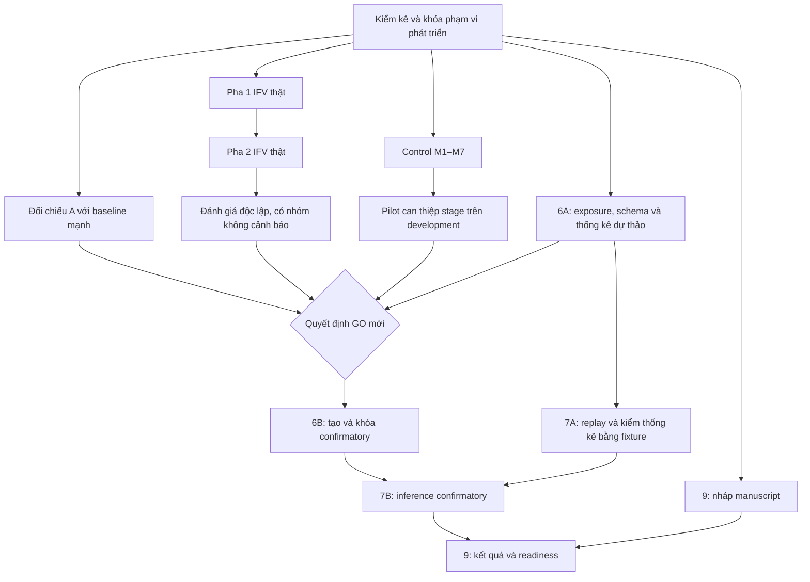

# EASE 2027 · Master execution

## Checklist P0–P4 · 21/11/2026

Đã tái lập D4 từ baseline `dd2e109`, kiểm lại P1/P2 và hoàn thiện thiết kế v3 cùng ledger cho các claim hiện tại. Ba ngưỡng và năm trần đã được chủ dự án chọn. Chưa có scientific lock hoặc quyền chạy prospective. [Nghiệm thu và biên bản](CHECKLIST_P0_P4_20261121.md)

## Audit P2 · 21/11/2026

Đã kiểm kê ảnh lịch sử, đối chiếu hash file và pixel, tìm nhóm gần trùng và đánh giá tám điều kiện trên từng cặp C2. D4 đã hoàn tất kiểm chứng development. AUTHOR, R02 và R03 đã hoàn thành hai pha. Round 1 đang mở và scientific gate vẫn là `NO_GO_SUPERIORITY`. [Bảng kết quả, giới hạn và lệnh tái lập](P2_AUDIT_VI.md)

## Khảo sát ngày 20/11/2026

Cả tác giả, R02 và R03 đã nộp đủ hai pha. Trên 42 ca chính, R02 và R03 khớp kết luận về giá trị ở 32 ca, khớp kết luận về quan hệ giữa hai ảnh ở 34 ca. Round 1 đang mở, chờ quyết định của chủ dự án về chốt vòng và phân xử. [Biên bản R03 pha 2](R03_PHASE2_REVIEW_INTAKE_20261120.md)

## Mốc kỹ thuật · 20/11/2026 — D4 P1 development

[Bản bàn giao tổng thể](../../PROJECT_HANDOFF_20261120_VI.md) là điểm vào khi
nhận việc. Từ mốc P0, D4 checked v2 vs MRZ-metadata-asserted đã được triển khai
trong adapter riêng, không sửa policy đóng băng. **72 constructed controls,
144 paired evaluations, 288 arm evaluations; 144 checked regressions chính xác;
8 ca/16 tier pairs chỉ divergence tại treatment, 0 divergence ngoài treatment.**
Replay lịch sử 46 ca không có approved reference nên semantic pointwise/relation
đều UNKNOWN; structure NO_FAULT theo parser. Full suite **579 tests + 6 subtests
PASS**. Receipts và outputs: [D4 development](execution/master_01/d4_development_20261117/).

Đây là development/software evidence, không phải superiority, dữ liệu mới,
human truth, cohort prospective hoặc bằng chứng chi phí end-to-end. Model calls,
training, annotation mới, approved references và prospective observations đều
bằng 0. R02 đã hoàn tất hai pha; R03 vẫn pending; Round 1 OPEN.
**GO_PREPARATORY_ONLY; NO_GO_SUPERIORITY; Research chưa sẵn sàng nộp.**
P2 pixel/lineage/C2 audit và các quyết định D1–D12 còn lại chưa khép.
Các mục bên dưới là snapshot lịch sử tại thời điểm ghi; không ghi đè receipts cũ.

Mốc mới nhất **17/11 — [R02 pha 2 hoàn tất 46/46](R02_PHASE2_REVIEW_INTAKE_20261117.md)**.
Pha 1 và pha 2 đều có 2 người hoàn tất: tác giả + R02; 1 người ngoài dự án theo
xác nhận organizer, không tự xác minh độc lập. Đã giữ raw bytes, niêm phong
đáp án theo pha 1 của R02 và tính agreement trước phân xử trên cùng 46 ca.
Primary pointwise khớp 30/42 (κ=0,5862), relation 33/42 (κ=0,6619); có 1 ca
binary pointwise đối nghịch. R02 ghi nhận A TP/FN=4/5, B3=9/0, C2 0/9 binary.
**432 tests + 6 subtests PASS**, 3.645 tệp cũ nguyên vẹn; verifier độc lập
kiểm 18 bảng agreement, 216 method panels và 12 bảng cảnh báo. Không đổi
phiếu, guard, mô hình hoặc báo cáo tác giả; không inference/training.
Round 1 OPEN, R03 PENDING, adjudication/approved references = 0;
**NO_GO_SUPERIORITY**, chưa mở TASK 6B/7B. [Receipt](execution/master_01/reviewer_intake_20261117_r02_phase2/README.md).
Các mốc bên dưới giữ ý nghĩa lịch sử, gồm cả những dòng từng chờ R02 pha 2.

Mốc **17/11**: [B continuation](B_CONTINUATION_REPORT_20261117.md) hoàn tất phần
chuẩn bị P0–P4 theo deep-research handoff. **411 tests + 6 subtests PASS**, 2.741
file frozen được bảo toàn. Strict intake kiểm cả 3 ZIP đã phát; workflow phê
duyệt/phân xử chỉ chạy synthetic, production approved = 0. Audit 22.861 JSON xác
nhận 192/1.000 instance đã exposure, 808 unknown; C2 1.100 candidate/0 eligible.
Accounting vẫn 492 nhóm/823 cells; 384 sizing scenarios chỉ là minh họa. Có
[protocol v2](B_PROSPECTIVE_PROTOCOL_DRAFT_v2_20261117.md), [outline/readiness](paper/B_EASE_READINESS_20261117.md)
và [D1–D12](B_OWNER_DECISIONS_20261117.md). Round 1 OPEN, R02 pha 2/R03 chờ;
`GO_PREPARATORY_ONLY`, `NO_GO_SUPERIORITY`, không inference/training hoặc TASK6B/7B.
Mỗi mốc được đồng bộ main; các con số/thời điểm bên dưới giữ ý nghĩa lịch sử.

Mốc B mới **16/11**: [Oracle Reliability & Abstention](B_ORACLE_RELIABILITY_20261116.md)
đã hoàn tất P0/P1/P2: policy v2 riêng, 58 control logic, replay 46 ca lịch sử,
336 tests + 6 subtests PASS; verifier độc lập tái tính 492 nhóm metric.
Tier chặt hơn giảm coverage nhưng vẫn có FP do hai nguồn cùng sai; chưa có
superiority. 0 inference/training/phiếu mới. [Protocol B](B_PROSPECTIVE_PROTOCOL_DRAFT.md)
là DRAFT_ONLY; Round 1 vẫn mở, R02 pha 2/R03 còn chờ. MIDV đã kiểm license/schema,
ít nhất 148 instance/10 loại có exposure lịch sử; chưa chọn cohort mới.
**NO_GO_SUPERIORITY**, không mở TASK 6B/7B. Các mốc bên dưới giữ nguyên lịch sử.

Mốc tiếp nhận R02 **16/11**: [86/86 mục pha 1 đã niêm phong](R02_REVIEW_INTAKE_20261116.md),
1 người ngoài dự án theo xác nhận organizer; đính chính role riêng, không sửa
phiếu. Đã tính agreement tác giả/R02 (21/86 mục bất đồng ít nhất một tiêu chí),
tạo ZIP pha 2 riêng 46 ca/30 ảnh. R02 pha 2 và R03 chưa nộp. **23 tests PASS**,
2.493 tài sản lịch sử giữ nguyên, báo cáo tác giả replay chính xác; không có
inference/training, gold hoặc GO mới. GitHub dùng **main duy nhất**; phần nhắc
branch progress và chưa có phiếu ngoài trong các mốc cũ bên dưới là lịch sử.

Mốc readiness 16/11: [phân tích và kết quả](READINESS_ANALYSIS_20261116.md),
[tìm kiếm phương pháp](METHODS_EVIDENCE_MAP_20261116.md). Đã chạy 255 cấu hình nguồn,
164 injected control và 118 ca parser thực trên 5 phiên bản mã. Bản sửa 118/118,
bản cũ 42/118; chỉ 2 lỗi lịch sử đã biết. A/flat khớp 64/64 primary control nhưng
có 11 ngoại lệ ở miền boundary; không claim tương đương phổ quát. Có verifier
stdlib tái chạy 596 parser calls. Không inference/training/phiếu mới; scientific
gate vẫn NO_GO_SUPERIORITY. [Receipt mốc](execution/master_01/readiness_20261116/README.md).
Các số test và trạng thái ở những mốc cũ bên dưới thuộc lịch sử riêng của chúng.
Kiểm cuối mốc readiness: **260 Python + 6 subtests PASS**, 460 tài sản không đổi;
[PDF Emerging 3 trang](paper/output/pdf/emerging_20261116.pdf) đã kiểm trực quan,
[gói replay](paper/readiness_replay_20261116.zip) chạy độc lập sau giải nén.

Mốc tiếp tục không chờ feedback **16/11/2026** đã hoàn tất
[reference controls](REFERENCE_CONTROLS_20261116.md): 252 lượt injected, 131 so sánh
khác nhau/13 cặp pixel; prototype reference-bound và baseline cùng thông tin có
kênh field trùng nhau. Đã làm rõ thêm false alarms của union và lỗi do reference
sai dùng chung. **245 Python + 6 subtests và 15 JavaScript PASS.** Không có inference,
training hoặc JSON reviewer mới. Phiếu cũ, source A/B3 và hai ZIP đang gửi giữ nguyên.
[Kết quả](execution/master_01/reference_stress_20261116/run_01/results.md).
[Kiểm cuối và bảo toàn](execution/master_01/reference_stress_20261116/completion_manifest.json).
Các số của mốc đầu ngày bên dưới giữ nguyên như lịch sử.

Cập nhật **16/11/2026**: đã triển khai [ba hướng A exploratory](A_DEVELOPMENT_20261116.md),
replay trên 132 lượt đóng băng và chuẩn bị [hai ZIP reviewer độc lập](REVIEWER_HANDOFF_VI.md).
A_change_union TP/FN pointwise 4/3 so với A cũ 2/5; A_dual 7/0 có kênh field
trùng B3, không là lợi ích mới vượt B3. Chưa có người ngoài trả phiếu, inference
hoặc training mới. Code, aggregate và tiến độ được đồng bộ theo
[chính sách GitHub](../../PROJECT_SYNC_POLICY.md) trên nhánh progress; main chưa gộp.
[Receipt catch-up](execution/master_01/development_20261116/catchup_sync.json).

Review cá nhân đã hoàn tất **86/86 ô pha 1 và 46/46
ca pha 2**. Đã nhập, niêm phong và replay nguyên trạng phiếu pha 2. Trạng thái
**COMPLETE_SINGLE_REVIEW_UNADJUDICATED**: 1 tác giả đánh giá, 2 phiên bản export
pha 1 và 1 export pha 2. Trong 42 primary: 26 có nhãn pointwise, 21 có nhãn
relation; 0 UNREVIEWED. Hậu kiểm có 17 cờ literal/15 primary. TASK 6B/7B giữ
NO-GO cho superiority. [Kết quả 15/11](IFV_RESULTS_VI.md) · [Hậu kiểm](execution/master_01/ifv_20261115/analysis.md).
[Trạng thái hiện tại](IFV_REVIEW_STATUS.md) · [Bước tiếp theo](IFV_REVIEW_GUIDE.md) ·
[Kế hoạch đến EASE 2027](EASE2027_ROADMAP_VI.md). Các đoạn ngày 09, 11 và
13, 14 và 15/11 bên dưới là snapshot lịch sử, không phải trạng thái hiện tại.

Checkpoint `master_01`, ngày local 09/11/2026. Phần development và chuẩn bị đã chạy. **IFV WAITING_FOR_HUMAN_REVIEW. TASK 6B/7B NO-GO. Manuscript ở mức draft.** Worktree local `research-document-recovery` trên `main`, HEAD `f5d130d93525e7633053edc03e6d9f6edeba7a6f`. Evidence Contract nằm trong mục untracked có sẵn. Không có tracked/staged diff. Worktree mentor sạch khi tiếp nhận.

Cập nhật 11/11/2026 tiếp tục đúng các TASK 6A, 7A, 8 và 9 bên dưới. Người dùng đã hoãn IFV. Phần việc độc lập với nhãn đã được hoàn thiện trong phạm vi hiện có. **0 inference hoặc training mới trong lượt tiếp tục này.** [Manifest lượt tiếp tục](execution/master_01/continuation_20261111/completion_manifest.json)

## Nhật ký thực thi

| ID | Mục tiêu / dependency | Trạng thái | File thay đổi và artifact | Test / model calls thực tế | Giới hạn và bước tiếp |
|---|---|---|---|---|---|
| M0 | Phục hồi từ local, đọc kế hoạch và kiểm artifact TASK 0–5.5 | PASS | [Intake code](master/intake.py), [receipt](execution/master_01/intake.json), [sau thực thi](execution/master_01/preservation_after.json) | Đọc lại tài liệu 695 dòng, đối chiếu 93 cache envelope, 23 tài sản checkpoint. 2.746 file và 6 log inference cũ khớp hash sau lượt. 0 calls | Không thấy Python/Uvicorn/Node nghiên cứu khi kiểm tên process. GPU owner bị giới hạn quyền. Server loopback phục vụ QA đã đóng |
| IFV | Giữ mù pha 1, khóa thật rồi mới mở pha 2 | PASS tooling, WAITING_FOR_HUMAN_REVIEW dữ liệu | [Report code](master/ifv_report.py), [trạng thái](execution/master_01/ifv_waiting.json), [Browser receipt](execution/master_01/ifv_browser_attempt.json), [phiếu đã có](local/task55_blind_review_v1/index.html) | 7 JavaScript test, gồm lưu/export/nạp draft, asset binding và thứ tự mở output trong fixture. Kiểm reporter bằng Python. 0 calls | 0 phiếu thật. 31 ảnh, 86 ô pha 1 và tối đa 46 ca pha 2. Timeout UI thật. User xuất JSON và gửi đường dẫn. Một người chấm chỉ dùng mô tả pilot |
| DIAG | Đối chiếu A/B0–B3/A_flat và ablation, cần audit đã có | PASS | [Diagnosis](A_B3_CAUSAL_DIAGNOSIS.md), [Coverage](CONTRACT_COVERAGE_MATRIX.md), [Methods](METHOD_DIFFERENCE_REPORT.md), [replay](execution/master_01/method_decision_replay.json) | Đối chiếu trên 120 verdict chính và 12 diagnostic. 0 calls | 42 khác biệt do precondition gốc. A không có alarm riêng trên panel. 41 B3-only chưa biết là đúng hay sai. Đợi IFV |
| MUT | Fault injection M1–M7 và oracle kiểm độc lập, dùng fixture | PASS development | [Code](master/faults.py), [results](AUTOMATED_FAULT_INJECTION_REPORT.md), [log](execution/master_01/faults_01.log) | 14 ca, 13 valid, 7 lỗi seeded quan sát. A và B3 cùng 5/5 structured fields. 0 calls | JSON và attribution có checker riêng. Chưa xác nhận lỗi tự nhiên hoặc coverage trên lịch sử bug |
| A+B / 8A | Can thiệp M2 trên cùng input, cần control và quota | PASS pilot, exploratory | [Runner](master/propagation.py), [Protocol](FAILURE_PROPAGATION_PROTOCOL.md), [Stage results](STAGE_INTERVENTION_RESULTS.md), [Value analysis](A_PLUS_B_VALUE_ANALYSIS.md) | 12 request, 2 dùng cache cũ và 10 CPU mới. 0 calls khi replay. Có receipt M3 gắn raw payload. 0 GPU | 3 ID, 1 reader, crop chủ động. 4 trường đúng→sai sau crop đều mất nguồn; trường đích vốn sai 3/3. Cần independent cause và flat stage baseline cùng thông tin cho claim mạnh |
| TRAIN | Chọn SUT đủ cho RQ | NO-TRAIN | [Quyết định](NO_TRAIN_DECISION.md) | 0 training. Các reader cũ đã ghim | Nếu cần transfer thì dùng checkpoint đã có trước, theo design cân bằng |
| 6A | Exposure, schema, SAP và preflight, cần metadata cho phép | PASS draft | [Design](CONFIRMATORY_PREPARATION_6A.md), [Exposure](execution/master_01/exposure_audit_final.json), [prelock](execution/master_01/prelock_readiness_v2.json), [SAP](STATISTICAL_ANALYSIS_DRAFT.md) | 14 nhóm metadata. Test ảnh khác bytes trùng pixel, overlap các trục và draft guard. 0 calls | Pixel và alias lịch sử có lỗ hổng. Pretraining unknown. Cần dữ liệu độc lập, nhãn, adequacy và quyết định mới |
| 6B | Khóa test xác nhận sau GO | BLOCKED | [Gate](REVISED_GO_NO_GO.md), [amendment](MASTER_RESEARCH_AMENDMENT.md) | 0 calls | Chưa có GO, verified endpoint, specimen manifest mới, đủ cụm hoặc lock. Không có test output mới được mở |
| 7A | Cache/resume, thống kê, replay và báo cáo | PASS tooling | [Hướng dẫn](TASK7_REPLAY_AND_REPORTING.md), [stats](master/statistics.py), [Python log](execution/master_01/master_python_03.log), [UI log](execution/master_01/master_ui.log) | 28 Python, 7 JS qua. Paired bootstrap, sign flip, Holm và CI/NA thử bằng fixture. Replay 0 calls | CI và metric IFV thực để NA, không lấy synthetic sizing làm power quan sát |
| 7B | Chạy confirmatory theo lock 6B | BLOCKED | [Gate 6A](execution/master_01/prelock_readiness_v2.json) | 0 calls | Đợi GO hợp lệ và lock trước khi chạy |
| 9A | Nháp manuscript, bảng claim, tài liệu tái lập, CFP | PASS draft | [Manuscript](paper/MANUSCRIPT_DRAFT.md), [BibTeX](paper/references.bib), [Claim ledger](paper/CLAIM_TO_EVIDENCE.md), [Replication](paper/REPLICATION_PLAN.md), [Checklist](paper/SUBMISSION_READINESS.md) | Kiểm CFP chính thức và nguồn BibTeX. Không có inference cho viết paper | Confirmatory results để placeholder. Cần định dạng ACM và audit ẩn danh trước nộp |
| 9B | Paper readiness và chọn track với bằng chứng | BLOCKED | [Checklist](paper/SUBMISSION_READINESS.md) | 0 calls | Research Track là mục tiêu. Short/RENE có điều kiện về mức đóng góp và bằng chứng. Chưa quyết định chuyển track hay nộp |

Các lượt thất bại được giữ. Lượt đọc stage receipt đầu sai khóa runtime; sửa riêng hậu kiểm, replay không gọi model. Lần mô phỏng sizing đầu không serialize NumPy integer; bản `_v2` có regression test. Tổng lượt này **10 CPU, 0 GPU, 0 training**. Các lượt cache/replay không tính vào inference mới. [Manifest bàn giao](execution/master_01/delivery_manifest.json)

## Nối lại từ checkpoint này

1. Mở lại worktree `D:/laptrinhcuatao/Ekyc/versions/research-document-recovery`. Kiểm `git status --short` và HEAD. Đọc file này, [bảo toàn cuối lượt](execution/master_01/preservation_after.json) và [preflight](execution/master_01/prelock_readiness_v2.json). Không cần chạy lại intake, TASK 5 hoặc stage execute đã có. Dùng receipt cache và replay của checkpoint này.
2. Cả hai pha cá nhân đã khóa. Đọc [kết quả](IFV_RESULTS_VI.md), [gate mới](REVISED_GO_NO_GO.md) và [protocol prospective](POST_IFV_PROTOCOL_DRAFT.md); không tiếp tục chờ phiếu đã nhận hoặc sửa snapshot theo output.
3. Dùng bản niêm phong pha 2 theo [hướng dẫn replay](IFV_REVIEW_GUIDE.md). Giữ báo cáo chính và sensitivity hậu kiểm riêng; không lấy withholding làm nhãn đã phân xử.
4. Chuẩn bị independent reference, endpoint và adequacy cho claim phù hợp, rồi quyết định GO mới. Chỉ sau đó mới tạo/khóa confirmatory. A+B giữ exploratory. [Phương án](MASTER_RESEARCH_AMENDMENT.md) · [Các điều kiện 6A](CONFIRMATORY_PREPARATION_6A.md)

Nguồn checkpoint cũ gồm [báo cáo phục hồi](RECOVERY_STATE.md), [gate](REVISED_GO_NO_GO.md) và [audit](TASK5_5_AUDIT.md).

## Phần hoàn thiện thêm ngày 11/11/2026

| TASK | Việc thực sự hoàn thiện | Kiểm chứng và trạng thái còn lại |
|---|---|---|
| 6A | Validator nhận diện hai path Windows cùng file, chặn nội dung author mâu thuẫn trong một ID và trùng semantic key sau chuẩn hóa. Kiểm hash binding của draft, exposure và manifest stage với receipt | Fixture thử path alias, content conflict, file thay hash và file thiếu. Metadata exposure cũ khớp receipt. Gate giữ BLOCKED. [Binding](execution/master_01/continuation_20261111/draft_binding_verification.json) |
| 7A | Reporter giữ đủ frame đã chọn khi pha 1 partial. Snapshot, reviewer và mẫu số được đối chiếu trước join. CI cần đủ cụm từng phía, số đếm phải nguyên, sign-flip phải một vector. Score replay kiểm digest nội dung và hash config ReaderSpec | 28 bài Python liên quan đã PASS. Các ca test nhãn nằm trong bộ nhớ fixture, không có phiếu người được tạo. [Log](execution/master_01/continuation_20261111/regressions_01.log) |
| 8 | Hoàn thiện so sánh flat/source-trace trên output đã cache, không mở thêm thí nghiệm | Trùng 24/24 giải thích trường và 4/4 trường suy giảm. Cả stage-diff và graph có 3/3 hit ở M2 trên crop chủ động. Natural root-cause accuracy giữ NA. Phần so sánh đã thiết kế hoàn tất; chưa có lợi ích riêng để mở rộng thêm. [Kết quả](execution/master_01/continuation_20261111/stage_baselines.json) |
| 9 | Có nguồn ACM review, diagram và tables. Có ZIP tái lập local gồm source A/B0/B2/B3/A_flat, output development giả lập và script kiểm độc lập | Sau giải nén, tiến trình Python riêng tái hiện 660 quyết định trên 132 ca. Kiểm thay file bị từ chối. TeX source qua kiểm môi trường, brace, sáu citations và scan định danh. PDF còn BLOCKED do máy thiếu compiler. [Archive](paper/candidate_20261111_02.zip) · [ACM source](paper/main.tex) |

Các file code được sửa là [exposure](master/exposure.py), [prelock](master/prelock.py), [statistics](master/statistics.py), [IFV report](master/ifv_report.py), [stage analysis](master/stage_analysis.py) và [lock schema](master/test_lock_draft.schema.json). File thêm cho phần việc đã có gồm [regression tests](tests/test_continuation_regressions.py), [đóng gói artifact](master/replication.py), [entry point verify](paper/verify_results.py), [nguồn ACM](paper/main.tex) và ZIP trên. Các protocol draft và tài liệu kết quả đã được cập nhật tại chỗ. Danh sách hash đầy đủ nằm trong manifest lượt tiếp tục. Bản byte cũ của các file sửa được giữ trong backup local.

Hai lỗi gặp khi hoàn thiện artifact đã được sửa và giữ chứng cứ. Adapter gói thử đầu truyền thừa graph cho B2, nên candidate đầu bị chặn. Candidate thứ hai giữ chữ ký graph-free và qua replay. Kiểm nguồn TeX phát hiện lỗi escape khi ghi file, đã ghi lại đúng nguồn và kiểm lại. Compiler TeX hiện chưa có nên không tuyên bố PDF đã compile hoặc kiểm layout. [Build log đầu](execution/master_01/continuation_20261111/replication_build_01.log) · [Candidate đạt](execution/master_01/continuation_20261111/candidate_20261111_02_receipt.json) · [TeX source checks](execution/master_01/continuation_20261111/acm_source_verification.json)

### Phần còn chờ và điểm resume

- IFV được hoãn theo yêu cầu của người dùng. Natural precision, recall, FAR, adjudication và triage time tiếp tục chờ phiếu thật. Không cần người dùng đánh giá ngay để hoàn tất các sửa lỗi ở lượt này.
- TASK 6B và 7B tiếp tục chờ GO mới, claim đủ phân biệt với baseline mạnh, specimen độc lập và nhãn có provenance. Bộ lock draft cùng code kiểm hash không cấp GO.
- TASK 9 còn compile/kiểm layout khi có TeX compiler, xác minh quyền phát hành và kiểm ẩn danh cuối trước khi xuất bản. ZIP hiện là candidate cục bộ đã kiểm scorer.
- Sau khi người dùng hoàn thành pha 1, dùng importer và snapshot SHA tại [IFV_REVIEW_GUIDE](IFV_REVIEW_GUIDE.md), rồi mới mở pha 2. Sau khi có phiếu pha 2 hợp lệ, dùng reporter hiện tại. Reporter mới vẫn nhận đúng đường dẫn `output_observations.json` đã niêm phong và giữ các ca chưa chấm trong UNREVIEWED. Các thí nghiệm đã hoàn thành tiếp tục dùng cache/receipt.

Dừng tại đây vì các phần độc lập trong phạm vi còn thiếu đã được xử lý. Công việc tiếp theo phụ thuộc nhãn thật, quyết định khoa học hoặc tài nguyên TeX. Không có branch, worktree hoặc workflow mới được tạo.

## Tiếp nhận phiếu thật ngày 13/11/2026

| Task ID | Mục tiêu / dependency | Trạng thái | Files changed / artifacts | Tests thực tế / model calls | Giới hạn / bước kế tiếp |
|---|---|---|---|---|---|
| 5.5 IFV import | Nhập JSON người dùng, đối chiếu packet và SHA | PASS import, PARTIAL observations | Export gốc và snapshot dưới `local/`; [intake](execution/master_01/ifv_20261113/intake.json), [readiness](execution/master_01/ifv_20261113/phase1_readiness.json) | 35 asset phiếu gốc khớp hash; nạp/xuất lại giữ đủ 86 câu trả lời; 0 calls | 19/86 đủ schema. Không cấp gold label, readability certificate hoặc tính độc lập |
| 5.5 IFV completion | Làm rõ thông tin còn thiếu, giữ nháp đã nhập | PASS logic, visual QA BLOCKED | `task55/review_core.js`, `review_ui.js`, `review_template.html`, `review_resume.py`; [phiếu tiếp tục](local/task55_blind_review_resume_ea62dbfc37a8/index.html) | 20 Python và 10 JavaScript PASS; [logs](execution/master_01/ifv_20261113/). Công cụ browser chặn `file:`; chưa kiểm trực quan | Thêm nguồn/vị trí cho 66 ô và sửa hai mâu thuẫn đã báo, tổng 67 ô trên 29 ảnh |
| 7A / gate | Kiểm tính đủ trước join output | PASS guard, BLOCKED phase 2 | `phase1_readiness.json` | Chỉ 1/46 cặp đủ hai quan sát; hàm gate từ chối pha 1 thiếu. 0 output packet, 0 labels pha 2, 0 model calls | Không dùng một cặp hoặc phần thiếu để suy ra precision/FAR/recall; chờ export bổ sung |
| 9 manuscript | Cập nhật độ phủ nhãn thật và giới hạn | UPDATED draft | `paper/MANUSCRIPT_DRAFT.md`, `paper/main.tex`, `paper/CLAIM_TO_EVIDENCE.md` | Chỉ thêm số liệu tiếp nhận đã kiểm, chưa có confirmatory | Không thay RQ hoặc diễn giải khác biệt A/B3 là lợi ích đã chứng minh |

Phát hiện lỗi sử dụng: nút “Xuất phiếu đã đánh giá” trước đây cho phép tải phiếu
partial mà không nêu đủ rõ điều còn thiếu; lỗi từng trường cũng chưa hiện ngay
khi render/nạp lại. Bản giao diện tiếp tục hiển thị lỗi tại từng trường, cho
chuyển nhanh ảnh thiếu và phân biệt xuất hoàn chỉnh với xuất một phần. Không
thay điều kiện validator, sample, oracle hoặc checkpoint. Asset của phiếu cũ
được giữ nguyên để đối chiếu hash; bản tiếp tục dùng cùng packet/ảnh và vùng nháp riêng.

Điểm resume: mở phiếu tiếp tục ở hướng dẫn, giữ cùng mã reviewer và bổ sung
các quan sát còn thiếu. Gửi JSON mới. Importer sẽ tạo snapshot mới; chỉ khi
pha 1 đủ thông tin mới gọi `open-stage2`. Sau phiếu pha 2 thật, dùng reporter
đã có để tính hai endpoint và xem lại GO/NO-GO. Bản export partial đã nhận vẫn
được giữ làm lịch sử; không chạy lại inference hoặc gán nhãn thay người.

## Tiếp tục ngày 14/11/2026

| Mốc | Kết quả thực tế | Bằng chứng / giới hạn |
|---|---|---|
| 5.5 pha 1 cá nhân | COMPLETE, SEALED: 86/86 ô, 31 ảnh | [Receipt](execution/master_01/ifv_20261114/phase1_readiness.json). Giữ nguyên từng câu trả lời; phiếu partial cũ vẫn giữ riêng |
| 5.5 pha 2 | READY: 46 ca = 42 primary + 4 diagnostic; 0 ca thiếu quan sát | Sửa đường dẫn ảnh theo đúng thư mục người chấm. Kiểm 92 liên kết/hash, 30 ảnh được dùng. Snapshot khóa trước khi truy cập cache |
| Review usability | Hiển thị đủ chữ nguồn và dòng MRZ; sao lưu nháp; xuất đủ hoặc xuất partial có thông báo | Backend từ chối draft làm nhãn thật. Browser chặn mở `file:` nên chưa kiểm trực quan; kiểm logic và hash báo riêng |
| Kiểm hồi quy | PASS: 187 Python + 6 subtests; 12 JavaScript | [Python](execution/master_01/ifv_20261114/python_tests_final.log) · [UI](execution/master_01/ifv_20261114/ui_tests.log). Chạy fixture tạm trong `local/qa14` để giữ đúng vùng xuất của generator; các lượt lỗi cấu hình trước đó vẫn giữ log |
| Giới hạn nguồn | 12 quan sát có chi tiết cần giữ bất định; 0/10 ca C2 đạt đồng thời điều kiện đọc rõ và backup theo guard hiện có | Kiểm nhất quán từ dữ liệu đã nhập, không tự sửa MRZ, đổi loại nguồn hoặc gán lỗi OCR. Không nới guard để tăng mẫu số |
| 9A và tiến độ | Đồng bộ nháp Markdown/ACM và claim ledger; đối chiếu CFP chính thức ngày 14/11 | [Roadmap](EASE2027_ROADMAP_VI.md). Research là mục tiêu; chưa có kết quả pha 2 hoặc GO mới |

Không có inference hay training mới. Trạng thái kiểm thử và bảo toàn cuối lượt
nằm tại [completion manifest](execution/master_01/ifv_20261114/completion_manifest.json).

## Luồng kỹ thuật độc lập khi chờ pha 2 · 14/11/2026

Lượt IFV phía trên có 0 inference; lượt kỹ thuật sau đó đã chạy **hai luồng
document inference thật trên thẻ tổng hợp** tại bản ứng dụng gốc. Không dùng
phiếu IFV, không thay parser hoặc reader của worktree nghiên cứu. Đã sửa hai
lỗi tách trường, kiểm trước–sau 8/12 → 12/12 ca token tổng hợp và chạy bộ
backend/API **113 PASS**, frontend camera **15 PASS**. Có kiểm manifest 21.050
ảnh và split theo ID trong bộ backend. 16 tài sản model không đổi; 0 training.

[Chi tiết công việc độc lập](INDEPENDENT_WORK_STATUS.md) ·
[Receipt](execution/master_01/independent_20261114/completion_manifest.json).
Các lượt kiểm API đầu bị kẹt ở socketpair của event loop Windows trong môi
trường hạn chế; lượt cho phép kết nối nội bộ đã qua cả bộ kiểm. Kết quả hai
thẻ tổng hợp là smoke kỹ thuật, không bổ sung nhãn lỗi IFV hoặc metric OCR
độc lập. Natural fault precision/FAR và confirmatory tiếp tục chờ đúng đầu vào.

## Hoàn tất review và phân tích ngày 15/11/2026

| Công việc | Kết quả / artifact | Giới hạn |
|---|---|---|
| Import pha 2 | 46/46 khớp packet/snapshot; export gốc và niêm phong dưới local; [intake](execution/master_01/ifv_20261115/intake.json) | 1 tác giả, chưa adjudicate; 0 câu trả lời đổi |
| Báo cáo 7A | [Replay chính](execution/master_01/ifv_descriptive_ece01b67a2f6af39.md): pointwise A 2/0/5/19, B3 7/3/0/16; relation A 2/0/0/19, B3 2/3/0/16 | 26/42 và 21/42 có nhãn; CI không đủ cụm; 4 diagnostic bất định |
| Hậu kiểm | [Code](master/ifv_analysis.py), [analysis](execution/master_01/ifv_20261115/analysis.md): 17 cờ/15 primary, giữ nguyên labels. Withholding hậu kiểm làm 3 FP B3 biến mất | Không thay bảng chính, không tự phân xử, không kết luận A hơn B3; 12/14 cảnh báo A chưa kết luận |
| Hướng tiếp theo | [Protocol prospective](POST_IFV_PROTOCOL_DRAFT.md), [gate](REVISED_GO_NO_GO.md), roadmap/manuscript/claim ledger đã cập nhật | NO-GO cho superiority 6B/7B; tiếp tục reference validity và coverage characterization |

Lượt này có 0 inference/training mới. Mọi phiếu và log inference cũ được
bảo toàn; kiểm thử, gói tổng hợp và hash cuối lượt nằm trong
[completion manifest](execution/master_01/ifv_20261115/completion_manifest.json).

## Development và bàn giao reviewer · 16/11/2026

| Mốc | Đầu ra đã có | Giới hạn / bước tiếp |
|---|---|---|
| A development | [Kế hoạch](execution/master_01/development_20261116/variant_plan.json), [hai panel](execution/master_01/development_20261116/variant_results.md), reader/contract slices và decision digest | Thiết kế sau pilot, 0 model calls; A_dual ghép B3 field/A relation; không thay frozen A hoặc chọn reference sau output |
| Reviewer handoff | Offline ZIP R02/R03, 31 ảnh/86 mục mỗi gói; phase-2 builder buộc seal riêng của người đó và bỏ author hint | 0 người mới thực nhận; không public ZIP ảnh/raw review. Tác giả không cần lặp lại phiếu |
| Chất lượng review | Kiểm omission/output, ghi chú khi literal lệch; công cụ raw agreement/kappa/alpha có missing/constant guards | Kiểm logic không tự sửa nhãn hoặc tạo gold. Agreement thực và phân xử còn chờ phiếu độc lập |
| Đồng bộ | [Catch-up đã push](execution/master_01/development_20261116/catchup_sync.json), source ứng dụng được lưu dưới engineering; AGENTS và sync policy ghi yêu cầu cho mọi mốc | Nhánh progress công khai, main chờ PR. Không coi public development repo là supplement ẩn danh đã duyệt |

Đọc [NEXT_ACTIONS](NEXT_ACTIONS.md) để tiếp tục reference/adequacy. Kết quả kiểm thử
và bảo toàn của mốc này nằm trong
[completion manifest](execution/master_01/development_20261116/completion_manifest.json).
