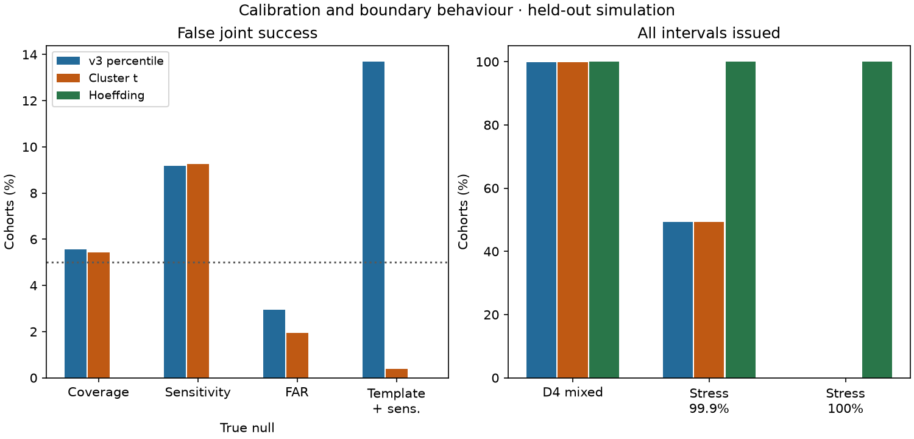
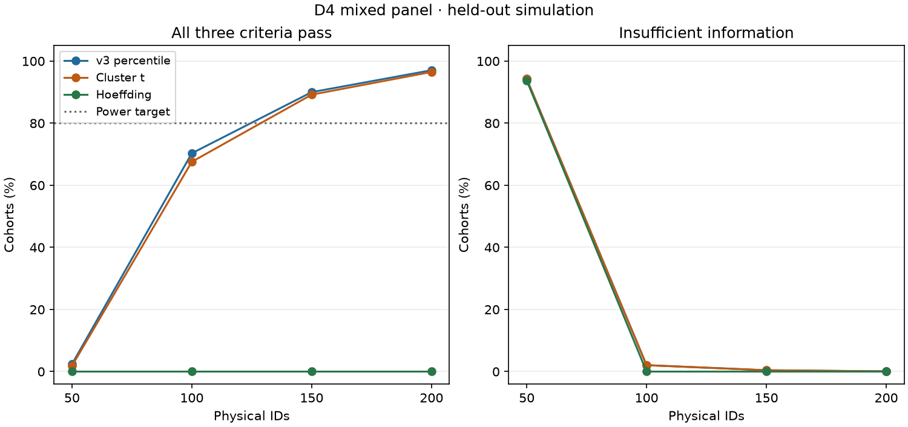

# P5B · Hiệu chuẩn thống kê và cơ chế D4

**Quyết định ngày 21/11/2026: giữ `GO_PREPARATORY_ONLY` và `NO_GO_SUPERIORITY`.** Trong trần 200 ID, không phương pháp nào đạt đồng thời mục tiêu power 80%, sai số loại I 5% và độ phủ cận dưới 95% theo tiêu chí đã ghi trước. Kết quả ở cả pha calibration và pha giữ riêng là `INFEASIBLE` cho thiết kế hỗn hợp tham chiếu và ba thủ tục đã thử. Hướng phù hợp hiện tại là **characterization**: mô tả khi nào kiểm literal làm hai arm bất đồng, bao nhiêu cảnh báo được rút và bao nhiêu lỗi có nhãn bị bỏ sót khi hoãn. [Thiết kế ghi trước](execution/master_01/p5b_calibration_20261121/design.json) · [Ma trận đầy đủ](execution/master_01/p5b_calibration_20261121/MATRIX.md)

## Cơ chế quyết định phạm vi claim

Nếu checked đưa kết luận nhị phân, asserted phải cùng kết luận. Khi literal không khớp, checked có thể chuyển FAULT hoặc NO_FAULT của asserted thành UNKNOWN. Vì thế giảm FAR trên N ca có nhãn không lỗi tối đa bằng min(1, D(1−C)/N). Số ca mất đi ở tử số FAR có thể đi kèm mất phát hiện thật. Một panel hỗn hợp có thể đạt cả ba ngưỡng **ở mức quần thể** với C = 88%, sensitivity = 94%, ΔFAR = 10 điểm. Nếu mọi can thiệp đều làm hỏng literal thực sự được dùng của trường sau biến đổi và mọi ca đều qua guard chung, C và sensitivity đều bằng 0. Trộn lẫn hai panel này sẽ cho diễn giải sai. Tám ca dựng sẵn có divergence không cho biết tỷ trọng của hai cơ chế trong một panel tương lai. [Chứng minh, ma trận 4 × 4 và mẫu số khi thiếu truth](D4_MECHANISM_BOUNDS_VI.md)

## Thiết kế và hai pha độc lập

Manifest được đẩy lên main tại `616014a` trước khi chạy. Có 23 kịch bản khả thi về xác suất, mỗi kịch bản chạy 800 cohort calibration và 1.600 cohort held-out. Tổng cộng **55.200 cohort synthetic**, cùng cohort cho cả ba phương pháp. Một cấu hình D4 yêu cầu vừa coverage 99,9% vừa giảm FAR 10 điểm bị loại trước khi lấy mẫu ở cả hai pha. Các seed dữ liệu của hai pha khác nhau. Seed bootstrap v3 vẫn là 20261121. Các giả định, ngưỡng và phương pháp được giữ suốt hai pha. P5 cũ dùng một cơ chế, giả định độ nhạy và mức bất đồng khác. Con số 65,9% của P5 và 97,1% của P5B trả lời hai câu hỏi có điều kiện khác nhau. [P5 đã khóa](P5_STATISTICAL_FEASIBILITY_VI.md)

Đơn vị là 50, 100, 150 hoặc 200 physical ID. Số ca cố định ở 4 hoặc theo chu kỳ 1–2–3–4 độc lập với kết quả. Mỗi ca được lấy từ bảng xác suất chung của truth, trạng thái ghép của hai arm và khả năng có nhãn. Trong mỗi ID, với xác suất ICC tất cả ca sao chép một tuple, nếu không chúng độc lập. Với template 5 ID, toàn bộ block có xác suất sao chép một tuple nữa. Với xác suất sao chép template t, tương quan giữa hai ID cùng template là t và trong cùng ID là t + (1−t)ICC cho một chỉ báo không hằng. Các block độc lập. Cụm, chuyển tiếp và nhãn được lấy cùng nhau. Tất cả dữ liệu là tổng hợp.

Hai họ cần đọc riêng. Họ D4 gồm `mixed` (cơ chế đơn điệu), `active` (literal đang hoạt động bị từ chối ở mọi ca). Họ `stress` cho phép đảo nhị phân và bất đồng hai chiều để thử estimator ở biên. Lưới gồm prevalence 2–30%, missingness đều hoặc phụ thuộc vào lỗi checked bỏ sót, ICC 0,20 và 0,65, độ bất đồng thưa, INVALID_TEST và UNKNOWN riêng. Các aggregate ghi mọi ô xác suất dương, target từng kịch bản, số lượt báo đạt từng metric, cùng đạt, xuất cận, độ phủ, lý do thiếu thông tin, thời gian và bộ nhớ. [Calibration](execution/master_01/p5b_calibration_20261121/calibration.json) · [Held-out](execution/master_01/p5b_calibration_20261121/held_out.json)

## Phương pháp nào kiểm soát được sai số?

| Phương pháp | Joint power calibration / held-out | Báo đạt sai khi sensitivity thật 79,99%, calibration / held-out | Độ phủ cận sensitivity ở kịch bản hỗn hợp, calibration / held-out | Kết luận cả hai pha |
|---|---:|---:|---:|---|
| Percentile v3 | 97,2% / 97,1% | 6,8% / 9,2% | 86,9% / 86,4% | INFEASIBLE |
| Đảo kiểm định t theo cụm | 96,9% / 96,5% | 7,0% / 9,2% | 85,6% / 85,4% | INFEASIBLE |
| Cận Hoeffding theo cụm | 0% / 0% | 0% / 0% | 100% / 100% | INFEASIBLE |

Ở held-out, v3 báo đạt 1.553/1.600 ở giả thuyết thay thế và 147/1.600 ở null sensitivity (Wilson 95%: 7,9–10,7%). Đảo kiểm định t cho 1.544/1.600 và 148/1.600 (7,9–10,8%). Hoeffding cho 0/1.600 ở cả hai (cận trên Wilson 0,24%). Độ phủ được tính trên các cohort xuất được cả ba cận, lần lượt là 1.599, 1.599 và 1.600 ở kịch bản hỗn hợp. Mọi xác suất “báo đạt” dùng toàn bộ cohort làm mẫu số. Ở null FAR đúng 5 điểm, báo đạt sai lần lượt 2,9%, 1,9% và 0%. Ở null coverage 79,99%, các tỷ lệ là 5,6%, 5,4% và 0%. Tại góc ba null, cả ba phương pháp cho 0 lần cùng đạt. So sánh riêng từng biên cho thấy vì sao chỉ xem góc này là chưa đủ. Các khoảng Monte Carlo là pointwise. [Toàn bộ số liệu và khoảng Monte Carlo](execution/master_01/p5b_calibration_20261121/MATRIX.md)

Cận Hoeffding cho bảo đảm hữu hạn mẫu mạnh nhất dưới giả định có các cụm độc lập, sức chứa từng cụm cố định, support đúng. Đổi lại, nó quá rộng trong trần. Không có cơ sở ghép hậu nghiệm Hoeffding khi suy biến và chọn cluster t ở các cohort khác. Bootstrap-t không được đưa vào chạy do pivot có thể chia cho sai số chuẩn bằng 0 ở mẫu thưa hoặc đồng nhất. [Công thức, giả định và nguồn phương pháp](B_PROTOCOL_V4_CANDIDATE.md)

## Các trường hợp thay đổi quyết định

- **Coverage 100% và 99,9%.** Trên stress không ràng buộc D4, 100% coverage làm v3 và cluster t thiếu thông tin ở 1.600/1.600 cohort. Hoeffding xuất đủ 1.600 bộ cận, cận coverage khoảng 91,35% cho 200 ID đồng cỡ. Ở 99,9%, hai phương pháp đầu thiếu thông tin ở 811/1.600 (50,7%). Hoeffding vẫn xuất đủ, nhưng không đạt đồng thời. Trên D4 thực sự, full coverage đồng nghĩa ΔFAR = 0.
- **Lỗi hiếm và mẫu số bằng 0.** Ở prevalence 2% và sensitivity quần thể 100%, cả 1.600 cohort held-out thiếu số cụm đóng góp để xuất cận ở cả ba phương pháp. Khi không có truth, sensitivity và ΔFAR đều không xác định. Ở bất đồng nonfault 0,6%, Δ nhỏ hơn margin, không cohort nào báo đạt, v3 và cluster t còn có các mẫu hoàn toàn hằng.
- **Thiếu nhãn có chọn lọc.** Khi khả năng có nhãn là 52% và giảm còn 0,3 lần trên lỗi bị bỏ sót, sensitivity có nhãn tăng từ 94% lên 98,12% dù sensitivity tiềm ẩn vẫn bằng 94%. V3 chỉ xuất cận ở 1.186/1.600 so với 1.569/1.600 ở missingness đều, joint pass giảm từ 80,1% còn 65,2%. Độ phủ cao sau khi loại các cohort suy biến không xác nhận độ nhạy trên mọi lỗi tiềm ẩn.
- **Template và số ca không đều.** Dưới null sensitivity có phụ thuộc template, v3 chỉ resample ID nên báo đạt sai 13,7%. Cluster t gộp đúng 40 block cho 0,4%, nhưng chỉ xuất khoảng ở 73/1.600. Trong panel không đều, độc lập giữa ID, joint power của v3/cluster t là 87,1%/85,8% và độ phủ sensitivity là 87,4%/85,8%. Gộp cụm đúng cấp và dùng tỷ số từ tổng đếm đều cần thiết.
- **Thời gian và bộ nhớ.** Trên 36.800 cohort held-out, tổng thời gian riêng phần inference lần lượt là 39,34 s (v3), 3,09 s (cluster t), 1,89 s (Hoeffding). Đỉnh cấp phát tăng thêm do `tracemalloc` ghi nhận trong một batch 16 lần lượt 24,18, 0,45 và 0,37 MiB. Đây là số đo cục bộ, không gồm độ trễ reader, toàn bộ RSS, thời gian tạo dữ liệu hoặc giờ công. Phần calibration có số đo riêng trong JSON.

## Cỡ mẫu và tài nguyên

Ở panel hỗn hợp, 150 ID là **điểm đầu của lưới đã xét** mà v3 và cluster t có joint power vượt 80% (90,0% và 89,2% trên held-out). 100 ID cho 70,3% và 67,6%. Cả hai vẫn thiếu độ phủ. Không xác định được cỡ mẫu tối thiểu đã hiệu chuẩn từ lưới này.

Để định lượng khoảng cách về tài nguyên, lấy đúng panel `mixed_200`, bốn ca/ID, độc lập giữa ID, và cận Hoeffding. Với mỗi r ở threshold, đặt d = E[X−rY]/4. Ba d lần lượt là 0,08; 0,0252; 0,036. Chia xác suất thất bại 20% thành năm phần 4% cho ba metric cùng hai guard 30 cụm. Một cỡ mẫu đủ cho mỗi metric là làm tròn lên của [(√(log(20)/2)+√(log(25)/2))/d]². Với q là tỷ lệ ca fault/nonfault có nhãn, xác suất một ID đóng góp ≥ q. Vì vậy yêu cầu nq−√(n log(25)/2) ≥ 30 là đủ cho mỗi guard. Thu được 971, 9.784, 4.794 ID cho ba metric, 286 và 55 cho hai guard. Dùng tối đa các giá trị cho **9.784 ID như một cận đủ bảo thủ**, chưa xác định được mức cần tối thiểu. Với bốn ca/ID, hai lượt đọc/ca, số này tương ứng 39.136 ca và 78.272 lượt đọc, vượt trần 9.584 ID và 76.672 lượt đọc. Đây chỉ là phép tính trên giấy. Với panel active 100%, mọi cỡ mẫu đều thất bại ngay ở estimand. [Phép tính độc lập](execution/master_01/p5b_calibration_20261121/verify.py)

Giữ nguyên trần 200 ID, 800 ca, 1.600 lượt đọc, 120 giờ công, 7 ngày và 50 GiB. Khả năng vận hành thực tế là `INSUFFICIENT_EVIDENCE`. Mô phỏng không xác định được tỷ lệ literal thực sự hoạt động, nhiễu giữa template, prevalence, missingness, chi phí thực, quyền dùng dữ liệu hoặc authority/reference. Không mở prospective, TASK 6B/7B hay thu nhãn. Bước tiếp theo trong phạm vi chuẩn bị là mô tả coverage, số cảnh báo rút, mất phát hiện thật, mẫu số truth và lý do hoãn theo trạng thái nguồn. Đề nghị chỉ xem lại hướng superiority khi có cơ sở độc lập cho panel, quyền và một thiết kế được duyệt có cả hiệu chuẩn lẫn power. Dừng chuỗi thử phương pháp ở đây.

## Tái lập và kiểm chứng

Từ gốc repo, các lệnh dưới ghi bản chạy mới vào thư mục local riêng. Các số đếm phải tái lập được, thời gian và đỉnh cấp phát có thể thay đổi. Verifier không import simulator hay candidate. Nó tái sinh hai pha từ seed, kiểm tất cả số đếm quyết định và độ phủ của hai ứng viên bằng phép kiểm trực tiếp tại r, kiểm percentile v3 ở điểm tham chiếu bằng đếm thứ hạng, đối chiếu verdict, mẫu số và phép tính sizing. Một unit test riêng so cả ba cận với entry point v3 thực sự trên ID không đều. [Biên bản hash và kiểm thử](execution/master_01/p5b_calibration_20261121/receipt.json)

~~~powershell
$py = '..\..\.venv\Scripts\python.exe'
$m = 'research.evidence_contract.oracle_reliability'
$b = 'research/evidence_contract/execution/master_01/p5b_calibration_20261121'
$out = 'research/evidence_contract/local/p5b_' + [guid]::NewGuid().ToString('N')
New-Item -ItemType Directory $out | Out-Null
Copy-Item "$b/design.json" $out
$env:OPENBLAS_NUM_THREADS = '2'
$env:OMP_NUM_THREADS = '2'
foreach ($stage in 'calibration','held_out') {
    & $py -X utf8 -B -m "$m.p5b_simulation" "$out/design.json" $stage "$out/$stage.json"
    if ($LASTEXITCODE -ne 0) { throw "Simulation failed for $stage" }
}
& $py -X utf8 -B "$b/verify.py" $out
& $py -X utf8 -B "$b/render.py" $out
& $py -X utf8 -B -m "$m.verify_d4" 'research/evidence_contract/execution/master_01/d4_development_20261117/controls_01'
& $py -X utf8 -B -m pytest -q -p no:cacheprovider research/evidence_contract/tests --basetemp "$out/pytest"
$files = (Get-ChildItem research/evidence_contract/tests/test_*.cjs).FullName
node --test --test-isolation=none @files
~~~
