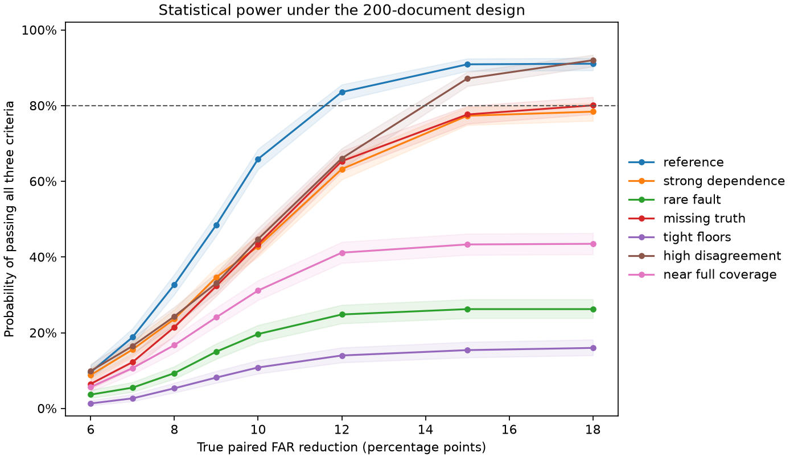
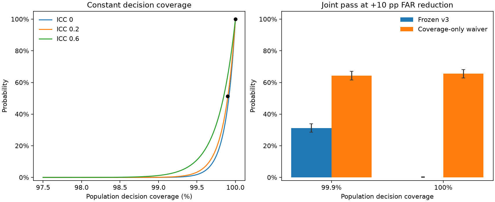

# P5 · Khả thi thống kê với 200 giấy tờ

**Kết luận cho thiết kế tham chiếu: INFEASIBLE ở mức giảm FAR thật 10 điểm phần trăm.** Với 200 ID, 4 ca/ID, 20% ca lỗi, 90% có truth và ICC 0,20, xác suất vượt đồng thời ba ngưỡng là **65,9%** (khoảng Monte Carlo 95%: 63,2–68,5%). Mức giảm FAR nhỏ nhất **trên lưới đã xét** đạt power 80% là **12 điểm phần trăm** (1.003/1.200 lượt đạt, 83,6%). Tuy nhiên, tăng hiệu ứng không sửa được vấn đề hiệu chuẩn: tại biên sensitivity, xác suất báo đạt sai vượt mức danh nghĩa 5%.

Trong 14 bộ giả định, hai bộ vượt tiêu chí **power riêng** tại +10 điểm: các ca độc lập (88,1%) và bất đồng hai arm thấp (90,0%). Cả 14 được phân loại `INFEASIBLE` khi xét đồng thời power, sai số loại I và độ phủ theo quy tắc P5. Kết luận áp dụng cho các giả định đã thử. Khả năng thực tế của dữ liệu tương lai vẫn là `INSUFFICIENT_EVIDENCE`. Không mở prospective, gọi reader, huấn luyện, thu phiếu hay gán nhãn thật. [Ma trận đầy đủ với khoảng Monte Carlo](execution/master_01/p5_simulation_20261121/MATRIX.md) · [Số đếm theo từng điểm](execution/master_01/p5_simulation_20261121/operating_points.json)

## Hiệu chuẩn, power và thiếu thông tin

Trong kịch bản tham chiếu, kiểm riêng ba tình huống mà ít nhất một điều kiện thật sự chưa đạt. Mỗi tỷ lệ dưới đây dùng **tất cả** 1.200 cohort làm mẫu số, kể cả khi v3 trả `INSUFFICIENT_INFORMATION`.

| Tình huống null | V3 báo đạt cả ba | Khoảng Monte Carlo 95% |
|---|---:|---:|
| Giảm FAR đúng 5 điểm, protocol đòi lớn hơn 5 | 56/1.200 · 4,7% | 3,6–6,0% |
| Coverage thật 79,99%, giảm FAR 15 điểm | 78/1.200 · 6,5% | 5,2–8,0% |
| All-fault sensitivity thật 79,99%, giảm FAR 15 điểm | 94/1.200 · 7,8% | 6,4–9,5% |

Ở +10 điểm, cả 1.200 cohort tham chiếu đều xuất cận. Xác suất cận dưới một phía 95% chứa giá trị thật (cận dưới ≤ giá trị thật) lần lượt là **92,9% cho coverage quyết định, 88,1% cho sensitivity và 95,8% cho chênh lệch FAR**. Cả ba cùng chứa giá trị thật ở 78,2% cohort. V3 không đặt bảo đảm 95% đồng thời cho ba cận. Trên seed dữ liệu độc lập, 2.400 cohort cho power 64,8% và độ phủ sensitivity 88,1%; thêm 2.400 cohort null sensitivity cho sai số loại I 8,7% (7,6–9,9%). [Kiểm lại seed và mẫu số](execution/master_01/p5_simulation_20261121/verification.json)

Khi tỷ lệ lỗi giảm còn 5%, power tại +10 điểm còn 19,7% và 58,5% cohort thiếu thông tin. Ở 2% lỗi, toàn bộ 1.200 cohort tại điểm này thiếu thông tin. Trong cả lưới chính, **20.658/181.200** cohort dừng trước bootstrap do có dưới 30 ID đóng góp cho ít nhất một mẫu số truth. Số lượt bootstrap có mẫu số bằng 0 trong các cohort còn lại là **0/1.605.420.000**. Hai con số đo hai nguyên nhân khác nhau. Tỷ lệ 0 quan sát được không bảo đảm điều đó trên mọi frame.

## Quy tắc bootstrap suy biến

Giữ nguyên mã v3. Với cùng resample, tính thêm một kết quả chẩn đoán chỉ bỏ kiểm tra *coverage hằng*. Kiểm tra đủ ID, mẫu số, hai metric còn lại và ba bất đẳng thức vẫn áp dụng.

| Coverage thật | V3 thiếu thông tin | V3 đạt ở +10 điểm | Đạt nếu bỏ riêng guard coverage | Báo đạt sai tại null sensitivity, v3 → bỏ guard |
|---|---:|---:|---:|---:|
| 99,9% | 615/1.200 · 51,25% | 31,2% | 64,3% | 3,4% → 8,0% |
| 100% | 1.200/1.200 · 100% | 0% | 65,6% | 0% → 7,8% |

Gọi C là coverage thật và qⱼ là xác suất một ID có đúng j quyết định trong m ca. Với trọng số 1−ICC, số quyết định có phân bố Binomial(m,C). Với trọng số ICC, cả m ca có cùng kết quả, nên j bằng 0 hoặc m. Khi mọi ID đều có m ca, xác suất cả 200 ID có cùng số quyết định bằng tổng của (qⱼ)²⁰⁰ với j từ 0 tới m. Khi đó mọi lần lấy mẫu lại cụm đều cho cùng coverage. Trong hình trái, đường biểu diễn xác suất tính theo công thức này. Hai chấm là tỷ lệ cohort mô phỏng mà v3 phát hiện coverage hằng tại ICC 0,20. Số lượt bootstrap hữu hạn và điều kiện đủ ID có thể tạo chênh lệch giữa hai phép tính.

**Ứng viên amendment cần kiểm riêng.** Nếu tất cả các ca đều có quyết định, bỏ guard và dùng cận percentile bằng 1 sẽ đánh giá quá chắc chắn khi coverage thật là 99,9%. Với các ID độc lập, đồng phân bố, cùng số ca, có thể thử cận nhị thức một phía cho xác suất *cả ID* có đủ quyết định: khi toàn bộ 200 ID đều đạt, cận là 0,05^(1/200) ≈ 98,51%. Xác suất này là cận bảo thủ cho xác suất một ca có quyết định trong mô hình đó. Việc ghép cận theo trường hợp vào một thủ tục tổng thể cần được kiểm tra lại trên null, missingness, cụm không đều và phụ thuộc template. Cận này cũng không giải quyết undercoverage của sensitivity. Đề xuất so sánh một phương pháp suy luận tỷ số có xét cụm hoặc kiểm định bằng đảo score với v3 trên lưới seed mới, trước khi xin duyệt amendment. P5 giữ nguyên guard và ngưỡng.

## Giả định sinh dữ liệu và tiêu chí phân loại

Lưới chính cố định 1.200 cohort/điểm, **151 điểm** trên 14 profile, một cỡ mẫu chính 200 ID và 2 hoặc 4 ca/ID. Điểm quyết định chính của P5 là +10 điểm; +5 là biên null, còn +6, +7, +8, +9, +10, +12, +15, +18 là lưới MDE. Chỉ xét hiệu ứng không lớn hơn tỷ lệ bất đồng. Tỷ lệ 80% dùng để đánh giá power là lựa chọn planning của P5. Protocol v3 quy định ba ngưỡng khoa học và cách tính cận. [Thiết kế và seed](execution/master_01/p5_simulation_20261121/design.json) · [Protocol gốc](B_PROTOCOL_V3_20261121.md)

| Profile | Thay đổi so với tham chiếu |
|---|---|
| reference | 200 × 4; prevalence 20%, truth 90%, ICC 0,20, checked abstention 7%, all-fault sensitivity 91%, bất đồng báo động trên nonfault 20% |
| independent / strong_dependence | ICC 0 / 0,60 |
| rare_fault / very_rare_fault | Prevalence 5% / 2% |
| missing_truth / informative_missing | Truth 55% đều; hoặc 75% với xác suất có truth của lỗi checked bỏ sót chỉ bằng 0,35 lần mức đó |
| low_disagreement / high_disagreement | Bất đồng báo động trên nonfault 10% / 36% |
| fewer_cases | 200 × 2 |
| tight_floors | Coverage và sensitivity thật bằng 83% |
| near_full_coverage / full_coverage | Abstention 0,1% / 0% |
| high_deferral | Abstention 50%, sensitivity 45%; xác suất đạt trong tình huống này là báo đạt sai |

Sinh kết quả paired ở cấp ca trước khi cộng theo ID. Trên nonfault, với q là bất đồng và Δ là giảm FAR, xác suất chỉ asserted báo động là (q+Δ)/2, chỉ checked là (q−Δ)/2, cả hai là 3%, còn lại cả hai im lặng. Trên fault, checked báo động với xác suất sensitivity. Báo động là một quyết định; trong các ca còn lại, simulator chọn thêm quyết định NO_FAULT sao cho coverage tổng thể bằng mức thiết kế. Các ca hoãn cùng có đóng góp bằng 0 cho tử số quyết định; UNKNOWN và INVALID_TEST có cùng đóng góp vào ba metric chính. Kết quả asserted trên fault không đi vào ba đại lượng chính. Simulator mô hình hóa trực tiếp các số đếm đủ dùng, không suy diễn hiệu quả của reader.

Mỗi ID độc lập. Với xác suất ICC, mọi ca của một ID chia sẻ toàn bộ tuple outcome/truth/missingness; các ID còn lại có ca độc lập. Biên được bảo toàn và tương quan nội cụm của từng chỉ báo ca không hằng bằng ICC trong mô hình này. Trong profile thiếu truth có chọn lọc, estimand sensitivity của v3 là sensitivity **trong số lỗi có nhãn**: s/[s+(1−s)×0,35], khoảng 96,7% dù sensitivity trên mọi lỗi tiềm ẩn là 91%. Tất cả kết luận coverage CI so với estimand tương ứng có nhãn. Đây là một nguồn bias nếu suy rộng sang các lỗi chưa gán nhãn.

Mỗi cohort đủ điều kiện dùng đúng 10.000 bộ trọng số lấy mẫu ID của v3, seed 20261121, thứ tự ID cố định, nearest rank thứ 500. Hai arm luôn dùng cùng ca. Cùng một profile dùng chung ngẫu nhiên giữa các mức hiệu ứng để giảm nhiễu so sánh. Các cohort độc lập trong một điểm; các điểm của lưới có tương quan. Khoảng Wilson 95% mô tả sai số Monte Carlo theo từng điểm, chưa điều chỉnh cho việc xem nhiều điểm. Khoảng này khác với cận bootstrap bên trong từng cohort. Cách tách mục tiêu, cơ chế sinh, estimand, phương pháp và chỉ tiêu báo cáo theo khung ADEMP. [Morris, White & Crowther](https://pubmed.ncbi.nlm.nih.gov/30652356/)

- **Power riêng tại +10 điểm:** `FEASIBLE` khi cận dưới Monte Carlo của xác suất đạt ≥80%; `INFEASIBLE` khi cận trên <80%; còn lại `INSUFFICIENT_EVIDENCE`.
- **Khả thi thống kê tại +10 điểm:** ngoài power, P5 kiểm ba null với mục tiêu sai số loại I ≤5% và độ phủ từng cận ≥95% trong các cohort xuất được khoảng. Nếu khoảng Monte Carlo loại trừ mức yêu cầu theo chiều xấu ở bất kỳ chỉ tiêu nào, hoặc power thiếu rõ ràng, kết luận `INFEASIBLE`. Chỉ gắn `FEASIBLE` khi cả power và các tiêu chí hiệu chuẩn đều được hỗ trợ theo các cận MC. Các trường hợp khác là `INSUFFICIENT_EVIDENCE`. Đây là quyết định theo từng profile giả định, không phải phép chứng minh kiểm soát lỗi trên toàn bộ composite null.
- **MDE:** báo cả mức đầu tiên có power ước tính ≥80% và mức đầu tiên cận dưới MC đạt 80%. Không nội suy ngoài lưới hoặc chọn lại ngưỡng sau khi xem kết quả. Khi hiệu chuẩn thất bại, MDE mô tả khả năng trả “đạt” của v3; chưa có MDE đã xác nhận ở mức loại I 5%. [Ma trận từng profile](execution/master_01/p5_simulation_20261121/MATRIX.md)

## Khả năng vận hành trong trần tài nguyên

Với 800 ca, giới hạn 120 giờ công tương đương **9 phút công/ca** nếu chưa trừ chuẩn bị và phân xử. Giới hạn 50 GiB tương đương **64 MiB/ca** trước log/cache cố định. Tối đa 1.600 lần đọc cho 2 ảnh/ca; hết toàn bộ số lượt thì không còn dư cho retry. Thời gian chờ hệ thống và thời gian lao động được hạch toán riêng.

| Ví dụ planning cho 800 ca | Lượt đọc | Giờ công | Lưu trữ | Ngày lịch theo giả định | Kết luận vận hành |
|---|---:|---:|---:|---:|---|
| 4 giờ công cố định + 7 phút/ca; 32 MiB/ca + 3 GiB; 20 giây/lượt | 1.600 | 97,3 | 28 GiB | 6,79 | Vừa trần nếu bố trí được nhân sự và không phát sinh retry |
| 4 giờ công cố định + 12 phút/ca; 64 MiB/ca + 5 GiB; 60 giây/lượt | 1.600 | 164 | 55 GiB | 11,69 | Vượt trần giờ công, lưu trữ và ngày lịch |

Hai ví dụ giả định hai người, mỗi người 8 giờ/ngày cả 7 ngày, chia đều công, thêm 8 giờ thiết lập máy và máy có thể chạy 24 giờ/ngày. Ngày lịch = giờ công/16 + (8 + tổng giờ đọc)/24; công việc và pha máy nối tiếp. Chưa đo các chi phí này, chưa có phê duyệt dữ liệu hoặc reference, nên **khả năng vận hành thực: INSUFFICIENT_EVIDENCE**. Ngay trong ví dụ vừa trần, kết luận thống kê tham chiếu vẫn là INFEASIBLE.

## Giới hạn và quy tắc dừng

Mô hình có số ca bằng nhau trong một profile, một reader, một ICC và một trường hợp missingness có chọn lọc. Chưa mô phỏng phụ thuộc giữa ID cùng template, ca timeout hoặc thay đổi mix theo loại lỗi MRZ. Mô hình cho phép hai arm bất đồng ngay cả khi cả hai đều đưa ra quyết định. Nếu D4 thực tế chỉ giảm cảnh báo bằng cách hoãn, thì Δ không thể vượt (1−coverage)/P(nonfault) khi truth đầy đủ; ở coverage 99,9% và 80% nonfault, trần cơ học đó chỉ là 0,125 điểm phần trăm. Do đó kịch bản gần 100% ở +10 điểm là stress test có chủ ý về **hành vi thống kê**, chưa có bằng chứng cơ chế D4 thực sự tạo được hiệu ứng đó. Tám ca MRZ dựng sẵn trước đây đều bị checked hoãn kết luận.

Kết thúc lưới tại số lượt đã định; không chạy thêm cho tới khi có kết luận thuận lợi. Lượt seed độc lập được ghi riêng để kiểm hai kết quả tham chiếu. Dừng trước mọi prospective vì hiệu chuẩn và power chưa đạt. Điều kiện để xem lại là một amendment được duyệt, kiểm định lại trên seed giữ riêng và cơ chế sát D4, cùng hồ sơ quyền/reference, truth, nhân lực và dung lượng có thể kiểm được. Việc giảm chuẩn nghiệm thu hoặc thay đổi guard cần một quyết định phiên bản riêng.

## Tái lập trong môi trường dự án

Từ thư mục gốc repo, lệnh dưới chỉ đọc thiết kế tổng hợp và mã nguồn. Chạy mới vào thư mục riêng. Lệnh kiểm chứng so lưới/seed, số đếm theo guard, xác suất và verdict, chạy lại điểm tham chiếu và hai điểm xác minh bằng seed độc lập. [Simulator](oracle_reliability/p5_simulation.py) · [Tests](tests/test_p5_simulation.py) · [Receipt](execution/master_01/p5_simulation_20261121/receipt.json)

~~~powershell
$python = '..\..\.venv\Scripts\python.exe'
$base = 'research/evidence_contract/execution/master_01/p5_simulation_20261121'
$out = 'research/evidence_contract/local/p5_' + [guid]::NewGuid().ToString('N')
New-Item -ItemType Directory $out | Out-Null
Copy-Item "$base/design.json" $out
$env:OPENBLAS_NUM_THREADS = '2'
$env:OMP_NUM_THREADS = '2'
& $python -X utf8 -B -m research.evidence_contract.oracle_reliability.p5_simulation "$out/design.json" "$out/operating_points.json"
& $python -X utf8 -B -m research.evidence_contract.execution.master_01.p5_simulation_20261121.verify $out
& $python -X utf8 -B "$base/render.py" $out
& $python -X utf8 -B -m pytest -q -p no:cacheprovider research/evidence_contract/tests/test_p5_simulation.py research/evidence_contract/tests/test_protocol_v3.py
~~~
