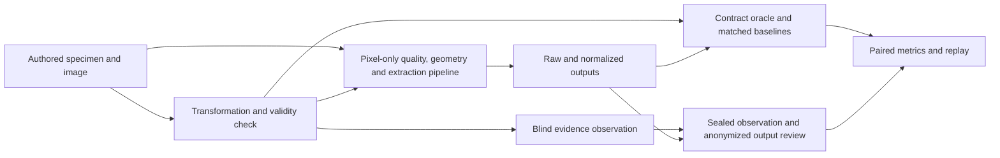

# Source-Aware Evidence-Contract Testing for AI-Based Document Verification Pipelines

**Working draft · anonymous · development findings only**

## Abstract

Document verification pipelines transform captured images before extracting structured fields. A field value may remain supported after one occurrence is occluded, while a crop may remove the only source for another field. These situations complicate software test oracles that compare only final values. We study evidence contracts that explicitly track source availability, apply tests subject to independently checkable preconditions, and separate field errors from transformation-related changes. In a development panel, a flat checker with the same eligibility rules reproduced every primary contract verdict. Controlled faults and a bounded crop intervention show how evidence records distinguish missing sources from retained-source errors. Independent fault validation and confirmatory comparisons are pending. The planned study tests whether the contracts provide a reliability or triage benefit over strong baselines given the same evidence.

## 1. Introduction

An image-to-fields pipeline makes engineering decisions at several boundaries. Image quality and rectification affect what reaches a reader, recognition determines which values can be extracted, and parsing determines how values become semantic fields. A changed result at the last boundary can reflect a lost source, incorrect extraction from a retained source, schema handling or an earlier error that survives the transformation. These mechanisms have different implications for testing and triage.

We investigate when source-aware contracts give engineers a more reliable test decision. The scope is extraction from fictional document specimens with explicit provenance. Identity matching, liveness and operational verification are outside the measured extraction interface.

## 2. Motivation

An identifier can appear in both printed text and a machine-readable zone (MRZ). A counterfactual that hides the printed occurrence leaves the identifier answerable when the MRZ remains valid and supplies the same field. Conversely, cropping can remove every valid realization, so continuing to assert the value may be an unsupported result. An evidence graph records alternate realizations and the context required for each realization.

For a neighboring field, an unchanged word image can still lose its semantic label. A test that assumes the field is preserved may report an invalid relation. A pointwise checker can detect a wrong value on the follow-up even when the original prediction was already wrong. The relation endpoint needs its own eligibility condition.

## 3. Related Work

GenMorph generates metamorphic relations and explicitly filters relations that cause false alarms or miss errors. Data fault injection for ML systems already studies the effects of deliberately corrupted inputs. These studies motivate admissibility checks and independent fault activation rather than novelty claims based on mutation itself. [GenMorph](https://arxiv.org/html/2312.15302v3) · [Data Fault Injection](https://researchportal.helsinki.fi/en/publications/software-framework-for-data-fault-injection-to-test-machine-learn/)

LMDX grounds extracted values in text locations, and OCRBench v2 evaluates visual text localization, parsing and reasoning. VeriOCRBench, currently cited as a preprint, studies whether OCR-grounded tasks are answerable and tests over-refusal. These lines of work motivate spatial support and validity. The endpoint studied here is the reliability of an external pipeline test oracle against the same outputs and evidence as its baselines. [LMDX](https://aclanthology.org/2024.findings-acl.899/) · [OCRBench v2](https://proceedings.neurips.cc/paper_files/paper/2025/hash/8c2e6bb15be1894b8fb4e0f9bcad1739-Abstract-Datasets_and_Benchmarks_Track.html) · [VeriOCRBench](https://arxiv.org/abs/2609.00232)

## 4. Research Gap

The empirical question is which parts of a document-specific oracle are needed once an evidence-matched flat baseline is available. In particular, we distinguish the effect of collecting source information, validating transformations, conditioning a relational decision, and representing evidence as a graph. When the flat baseline already receives availability and valid-value information, any incremental gain must appear in decision coverage, verified fault discovery, diagnostic accuracy or cost. A finite pilot can expose equivalence under specific conditions and motivate stronger confirmation.

## 5. Proposed Method

For each semantic field, we represent alternative valid realizations with OR. A realization may require all its value and semantic-context components. Each component carries coordinates, provenance and visibility evidence. MRZ validity requires the applicable format, checksum and linkage conditions. Coverage of annotated sources is recorded independently of the visibility of the listed sources.

| Contract | Preconditions | Endpoint |
|---|---|---|
| C1 Complete evidence removal | Scope is sufficient and every valid source is absent | Assertion without support, or appropriate refusal |
| C2 Alternative source remains | Main source removed, another validated source supports the field | Correct extraction, wrong value, or omission |
| C3 Neighbor non-interference | Preserved value and semantic context, correct original result for the relation | A follow-up error on a retained neighbor |
| C4 Evidence-preserving geometry | Supported operator and preserved readable evidence, correct original for the relation | A follow-up error under the transformation |

Invalid tests, inconclusive outputs and alerts from incomplete scope are recorded separately. In IFV, reviewers first describe visible regions and observed transcriptions without predictions, labels or method verdicts. Once sealed, they inspect anonymized predictions, record why the test is valid, and verify the candidate error. We retain both alert and non-alert cases.

## 6. Research Questions

- **RQ1.** Do contracts reduce false alarms relative to evidence-matched frozen oracles while retaining sensitivity and decision coverage?
- **RQ2.** Do contracts detect more verified transformation-specific software regressions than generic per-field checks on the same execution set?
- **RQ3.** Does source-conditioned test generation discover more verified fault families than validity-filtered random selection under a matched budget?

An exploratory extension asks whether stage interventions and evidence traces distinguish geometry loss from downstream extraction errors. It requires independent fault provenance and equally informative baselines for a comparative localization claim.

## 7. Experimental Design

**Subjects and datasets.** Historical development pilots use fictional authored cards and frozen OCR/VLM readers. In the primary Task 5 panel, 120 scheduled checks span three document IDs. Repeated views and reader outputs within one ID are dependent. The blind evidence packet has 31 unique images and 86 field slots across the whole development panel. The planned output review covers up to 46 distinct comparisons sampled before labels, including alarms and non-alarms. A future confirmatory cohort needs newly authorized specimens with verified ID, content, pixel and provenance separation. Capture and model pretraining exposure are documented with their uncertainty.

**Baselines.** B0 compares full field reference, B1 samples from the same validity-filtered domain, B2 uses a source-agnostic relation, and B3 checks post-transformation values against available evidence. Gated legacy V3 and the flat conditional checker receive the same evidence as A. Inputs, model calls, preprocessing and reader configurations are paired. The causal-stage pilot adds aggregate F1, per-field raw/rectified comparison and stage hashes without source reasoning.

**Evaluation.** Report valid-test denominators, false-alarm rate, sensitivity and decision coverage separately from alarms on invalid or uncertain cases. Repeat comparisons at the physical-ID or verified fault-family level, depending on the research question. Report budget prefixes and verified unique faults rather than counting multiple alerts for one fault. The draft analysis plan uses a paired cluster bootstrap and Holm adjustment with sensitivity and coverage guards. Seeded faults, natural behavior and verified historical software faults are separate panels. [Holm procedure](https://www.jstor.org/stable/4615733)

## 8. Results

### Development observations

- A and B3 agreed on 78 of 120 primary verdicts. The flat conditional checker reproduced 120 of 120 A verdicts. All 17 A alerts were among the 58 B3 alerts. The 42 verdict disagreements followed from the original-output prerequisite in C3/C4. Independent review is pending for the B3-only alerts.
- On 14 controlled cases, both A and B3 detected all five activated structured-field faults. Separate attribution and JSON checks detected two faults outside this endpoint. These are fixture observations.
- In the three-ID stage pilot, correct rectification changed no field correctness relative to raw input. A deliberately bad crop caused four correct-to-wrong field transitions, all in fields with source loss by construction. The three planned crop targets were already wrong before crop. The field results replayed exactly with no fresh model calls.
- Completing the evidence-matched stage comparison reproduced all 24 graph explanations with a flat source checker, including all four degraded fields. Stage differences and source traces identified the known M2 intervention in all three crop pairs. Natural software-fault localization remains unmeasured.

### Confirmatory results to populate after a verified lock

| Claim | Planned result | Current state |
|---|---|---|
| RQ1 reliability | Paired FAR, coverage, sensitivity, their intervals and guards | Pending independent labels and confirmatory data |
| RQ2 fault discovery | Verified root-cause family recall and known-good FAR | Pending fault provenance and confirmatory data |
| RQ3 yield at budget | Matched discovery curves, marginal yield, setup and review cost | Pending verified faults and locked budgets |
| Exploratory stage diagnosis | Classification of evidence loss and retained-source error, uncertainty, triage time | Development feasibility only |

## 9. Discussion

The development results support an information-parity check. Explicit relations can narrow the type of error being reported, but the additional eligibility rule can also turn an observable pointwise error into an inconclusive relation. This explains a difference in alerts without assigning a false-alarm label to either method. Recording the evidence that survived a crop adds an explanation to a field-level difference. A strong baseline given the same evidence and stage trace could produce the same explanation. A later comparison can test that boundary explicitly.

## 10. Threats to Validity

- **Construct.** Geometry is a proxy for availability on authored fixtures. Human legibility, semantic linkage, typed precision, and true absence need separate evidence.
- **Internal.** Shared matchers can give identical errors. A diagnostic invalid transformation may falsely increase baseline alarm counts. The two-phase blind review separates evidence collection from model output and records potential prior exposure.
- **Conclusion.** The development panel has few physical IDs, dependent views, absent adjudication and one reader in the stage pilot. Positive toy controls are not independent natural failures. Report effect sizes, sample selection, uncertainty and guards before drawing general conclusions.
- **External.** Authored fixtures under a single synthetic projection do not represent all capture devices, layouts, languages, readers or model pretraining histories. Independent specimen coverage and a rights review are pending.

## 11. Conclusion

Evidence contracts make test admissibility and the scope of a document extraction alarm explicit. The current pilots explain verdict differences and establish replay feasibility. Evidence for superiority over a flat, information-matched checker remains pending. The next phase needs independent labels, a locked cohort and endpoints that distinguish useful diagnosis from additional test instrumentation.

[Local claim matrix](CLAIM_TO_EVIDENCE.md) · [Verified bibliography](references.bib) · [ACM review source](main.tex)
